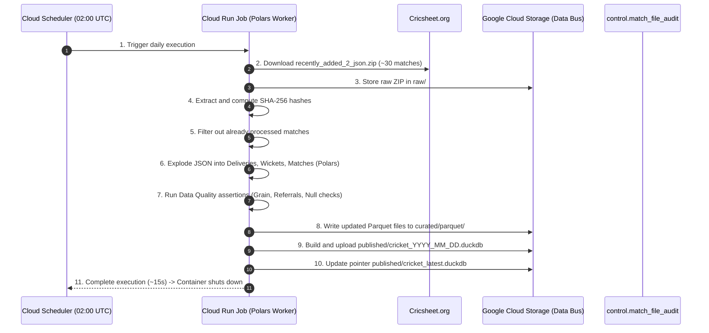
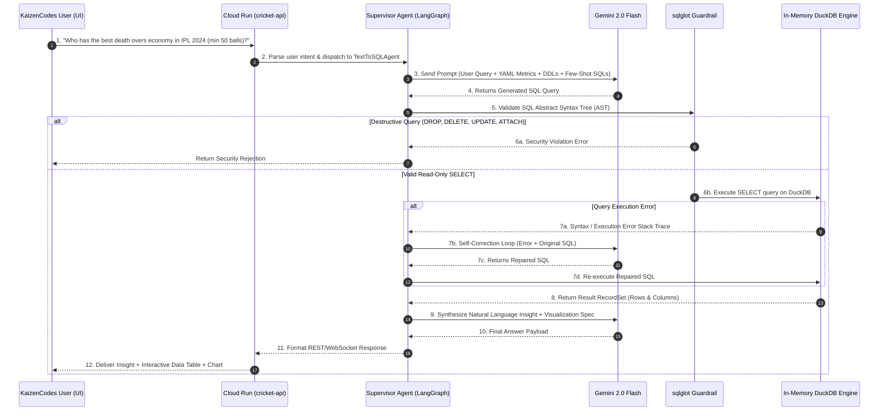

# 01 — System Architecture & Decoupling Blueprint

> **Status**: Approved Architecture  
> **Target Environment**: Google Cloud Platform (GCP Serverless) / Cloud-Agnostic Object Storage  
> **Cost Profile**: $0 to $3 / month (Scale-to-Zero)

---

## 1. Architectural Philosophy: Decoupled & Micro-Subsystem Design

Legacy data platforms suffer from heavy coupling: monolithic Airflow schedulers crashing when tasks fail, DuckDB database file locks when multiple readers and writers clash, and high idle server costs ($150–$400/mo).

The redesigned **Cricket Intelligence Platform** decouples the ecosystem into **three independently versioned, independently deployed subsystems** connected via an **Immutable Storage Data Bus**.

```mermaid
flowchart LR
    subgraph S1["Subsystem 1: DE Pipeline"]
        direction TB
        P1["Polars Ingest Worker"]
        P2["DuckDB Transform & DQ"]
    end

    subgraph Bus["Immutable Data Bus (GCS / R2)"]
        direction TB
        B1["raw/ JSON & CSVs"]
        B2["curated/ Parquet Files"]
        B3["published/ cricket_latest.duckdb"]
    end

    subgraph S2["Subsystem 2: BI & Dashboards"]
        direction TB
        D1["Evidence.dev / Next.js"]
        D2["Read-Only DuckDB Engine"]
    end

    subgraph S3["Subsystem 3: GenAI Microservice"]
        direction TB
        A1["FastAPI (cricket-api)"]
        A2["Gemini 2.0 Flash Multi-Agents"]
        A3["sqlglot AST Guardrails"]
    end

    S1 -->|1. Write Snapshots & Parquets| Bus
    Bus -.->|2. Read Snapshots (Zero Lock)| S2
    Bus -.->|3. Read Snapshots & DDLs| S3
```

---

## 2. Core Subsystems Specification

### 2.1 Subsystem 1: Headless & Ephemeral DE Ingestion Pipeline
- **Execution Model**: Headless container executed via **Cloud Scheduler + Cloud Run Job** (or GitHub Actions).
- **Runtime**: Ephemeral (~15 seconds daily for incremental delta; ~2–3 minutes for 21,000+ match backfill).
- **Core Engine**: **Polars + DuckDB Python** (replaces heavy Spark & Java runtimes).
- **Contract with Data Bus**: Produces partitioned, columnar Parquet files and builds a single, validated `published/cricket_latest.duckdb` file.

### 2.2 Subsystem 2: AI-Ready Data & Semantic Layer
- **Components**:
  - **YAML Metric Definitions**: Single source of truth for cricket calculations (Strike Rate, Economy, Dot Ball %, Clutch Index).
  - **Entity Resolution Engine**: Resolves Cricsheet abbreviations (`V Kohli`, `RG Sharma`) to canonical full identities (`Virat Kohli`, `Rohit Sharma`) and cross-site IDs (ESPNcricinfo, Cricbuzz).
  - **Schema Catalog & Golden SQL Registry**: Pre-parsed DDLs and 50+ hand-curated few-shot SQL queries for agent in-context learning.

### 2.3 Subsystem 3: Generative AI Microservice (`cricket-api`)
- **Service Type**: Standalone Serverless Container on **Google Cloud Run**.
- **Scaling**: Scales from **0 to 10 instances** on-demand; **$0.00/hr when idle**.
- **Core Engine**: **FastAPI** + **Embedded In-Memory DuckDB** + **sqlglot AST Guardrails** + **Gemini 2.0 Flash**.
- **Roles**:
  - Validates and executes natural language Text-to-SQL queries with a 3-turn self-correction loop.
  - Generates tactical opponent scouting reports and matchup simulations.
  - Serves public REST analytics endpoints (`/api/v1/players`, `/api/v1/matches`, `/api/v1/leaderboards`).

---

## 3. End-to-End Operational Workflows

### 3.1 Daily Ingestion & Snapshot Publication Flow



---

### 3.2 Generative Text-to-SQL & Multi-Agent Query Flow



---

## 4. Key Architectural Invariants & Guardrails

1. **Zero Database Lock Conflicts**:
   - The DE Ingestion worker **never writes** to a shared database file that is being read by live users. It generates a new timestamped snapshot file (`cricket_2026_08_30.duckdb`), validates it, and updates the `latest` pointer.
   - `cricket-api` loads snapshots in **read-only mode** or mounts them into RAM.
2. **Immutable Bronze & Revision Dedup**:
   - Bronze match data is append-only with composite primary key `(match_id, revision)`.
   - Silver and Gold consumers filter on `MAX(revision)` per `match_id`, guaranteeing idempotency and auditability.
3. **AST SQL Execution Guardrails**:
   - Every SQL query generated by LLM agents is parsed via `sqlglot`.
   - Allowed: `SELECT`, `WITH` (CTEs), `JOIN`, `WHERE`, `GROUP BY`, `HAVING`, `ORDER BY`, `LIMIT`.
   - Strictly Forbidden: `DROP`, `DELETE`, `INSERT`, `UPDATE`, `ALTER`, `CREATE`, `ATTACH`, `COPY`, `PRAGMA`, `EXPORT`.
