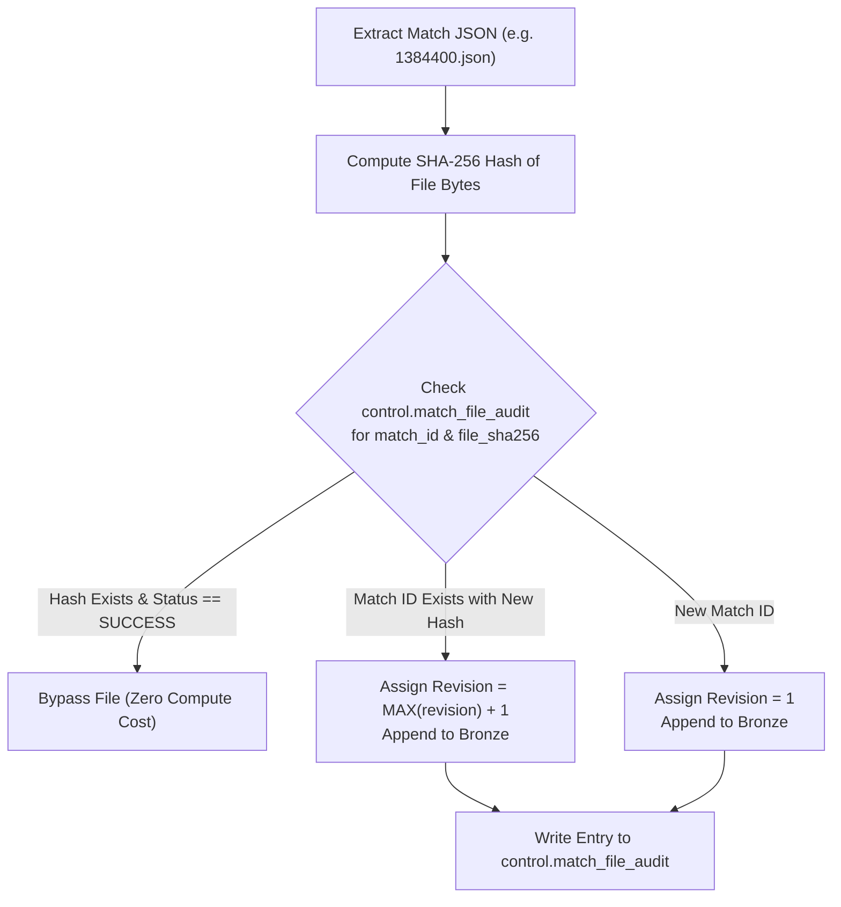

# 02 — Data Engineering Lakehouse Pipeline Specification

> **Focus**: High-Speed Ingestion, Polars Normalization, Idempotency Ledger & Parquet Publishing

---

## 1. Source Systems & Ingestion Profiles

The pipeline sources cricket data from [Cricsheet](https://cricsheet.org), which provides canonical ball-by-ball matches and player identity registries:

```
cricsheet.org
    ├── all_json.zip ─────────────────── (Monthly Historical Backfill: ~21,600 matches)
    ├── recently_added_2_json.zip ────── (Daily Incremental Delta: ~30 matches/day)
    ├── people.csv ───────────────────── (Player Registry: 17,700+ unique identities)
    └── names.csv ────────────────────── (Name Variations & Alias Crosswalk)
```

### Ingestion Profiles Matrix

| Pipeline Scope | Source File | Frequency | Runtime | Strategy |
| :--- | :--- | :--- | :--- | :--- |
| **Historical Backfill** | `all_json.zip` | One-off / Monthly | ~2–3 minutes | Full extraction, SHA-256 ledger initialization, full Parquet rebuild. |
| **Daily Incremental** | `recently_added_2_json.zip` | Daily (02:00 UTC) | ~15 seconds | Delta download, SHA-256 hash comparison, append new revisions, snapshot publish. |
| **Player Registry** | `people.csv`, `names.csv` | Weekly (Sunday) | ~5 seconds | Unpivot `key_*` identifiers, map aliases, build `dim_player` crosswalk. |

---

## 2. Storage Layout & Object Storage Contract

All data lands and is organized inside the primary bucket (`gs://kaizencodes-cricket-data/` or Cloudflare R2):

```
gs://kaizencodes-cricket-data/
├── raw/
│   ├── match_data/
│   │   ├── zip/snapshot_date=YYYY-MM-DD/archive=all_json.zip
│   │   └── zip/snapshot_date=YYYY-MM-DD/archive=recently_added_2_json.zip
│   └── register_csv/snapshot_date=YYYY-MM-DD/
│       ├── people.csv
│       └── names.csv
│
├── curated/parquet/
│   ├── bronze/
│   │   ├── match_data/partition=_snapshot_date/*.parquet
│   │   └── register_people/partition=_snapshot_date/*.parquet
│   ├── silver/
│   │   ├── matches/partition=season/*.parquet
│   │   ├── deliveries/partition=season/*.parquet
│   │   ├── innings/*.parquet
│   │   ├── wickets/*.parquet
│   │   ├── match_players/*.parquet
│   │   ├── match_officials/*.parquet
│   │   └── persons/*.parquet
│   └── gold/
│       ├── dim_player/*.parquet
│       ├── dim_match/*.parquet
│       ├── dim_venue/*.parquet
│       ├── fact_delivery/*.parquet
│       └── marts/
│           ├── mart_player_batting_career/*.parquet
│           └── mart_player_bowling_career/*.parquet
│
└── published/
    ├── cricket_2026_08_30.duckdb      # Historical timestamped snapshot
    └── cricket_latest.duckdb          # Symbolic pointer / active serving snapshot
```

---

## 3. Idempotency & Revision Tracking Engine

To ensure that running pipelines multiple times never corrupts or duplicates data, we implement a **SHA-256 Hash Ledger**:



### PostgreSQL / SQLite Ledger DDL:
```sql
CREATE TABLE IF NOT EXISTS control.match_file_audit (
    match_id         VARCHAR(64) NOT NULL,
    file_sha256      VARCHAR(64) NOT NULL,
    revision         INTEGER NOT NULL DEFAULT 1,
    file_size_bytes  BIGINT NOT NULL,
    archive_file     VARCHAR(128) NOT NULL,
    snapshot_date    DATE NOT NULL,
    status           VARCHAR(32) NOT NULL, -- 'SUCCESS', 'FAILED'
    ingested_at      TIMESTAMP WITH TIME ZONE DEFAULT CURRENT_TIMESTAMP,
    PRIMARY KEY (match_id, file_sha256)
);
```

---

## 4. Complex Cricket Domain Edge Cases Solved

1. **Multi-Wicket Deliveries**:
   - *Problem*: In source JSON, a single ball can record multiple wickets (e.g. batsman stumped + non-striker run out). Joining naively causes delivery row explosion.
   - *Solution*: `fact_delivery` CTE dedupes with `QUALIFY ROW_NUMBER() OVER (PARTITION BY match_id, innings_number, over_number, delivery_number ORDER BY CASE WHEN wicket_kind IN ('bowled', 'caught', 'lbw', 'stumped') THEN 1 ELSE 2 END) = 1`. This preserves atomic 1-row-per-ball grain while logging secondary dismissals in `fact_wicket_detail`.
2. **Season Formatting Inconsistency**:
   - *Problem*: `season` in source JSON appears variously as `"2011/12"`, `"2024"`, or integer `2007`.
   - *Solution*: Normalizer converts all seasons to standardized string format `YYYY` or `YYYY/YY`.
3. **Dismissal Attribution Subject**:
   - *Problem*: `wickets[n].player_out` is the authoritative dismissed batsman, which differs from `batter` on non-striker run-outs.
   - *Solution*: Explicitly join `wickets.player_out` against `dim_player.player_id` instead of assuming `batter_id`.
4. **Rain-Affected Matches & DLS Method**:
   - Match metadata extracts `target_runs`, `target_overs`, and `dls_applied` flags into `dim_match` to prevent skewing strike rate / required run rate metrics.

---

## 5. Automated Data Quality (DQ) Gateways

Before published Parquets and DuckDB snapshots are promoted to the live serving layer, automated DQ checks must pass 100%:

```python
def run_quality_gates(con: duckdb.DuckDBPyConnection) -> bool:
    checks = [
        # 1. Uniqueness test for dim_player
        "SELECT COUNT(*) - COUNT(DISTINCT player_id) FROM gold.dim_player == 0",
        # 2. Referential integrity: deliveries without valid match
        "SELECT COUNT(*) FROM gold.fact_delivery fd LEFT JOIN gold.dim_match dm ON fd.match_id = dm.match_id WHERE dm.match_id IS NULL == 0",
        # 3. No negative runs or extras
        "SELECT COUNT(*) FROM gold.fact_delivery WHERE runs_batter < 0 OR runs_extras < 0 == 0",
        # 4. Valid over numbers (1 to 50 for white ball, 1 to 200 for test)
        "SELECT COUNT(*) FROM gold.fact_delivery WHERE over_number < 1 OR over_number > 250 == 0",
        # 5. Delivery grain uniqueness
        "SELECT COUNT(*) FROM (SELECT match_id, innings_number, over_number, delivery_number, COUNT(*) FROM gold.fact_delivery GROUP BY 1,2,3,4 HAVING COUNT(*) > 1) == 0",
    ]
    for check_sql in checks:
        result = con.execute(check_sql).fetchone()[0]
        assert result is True, f"Data Quality Check Failed: {check_sql}"
    return True
```
