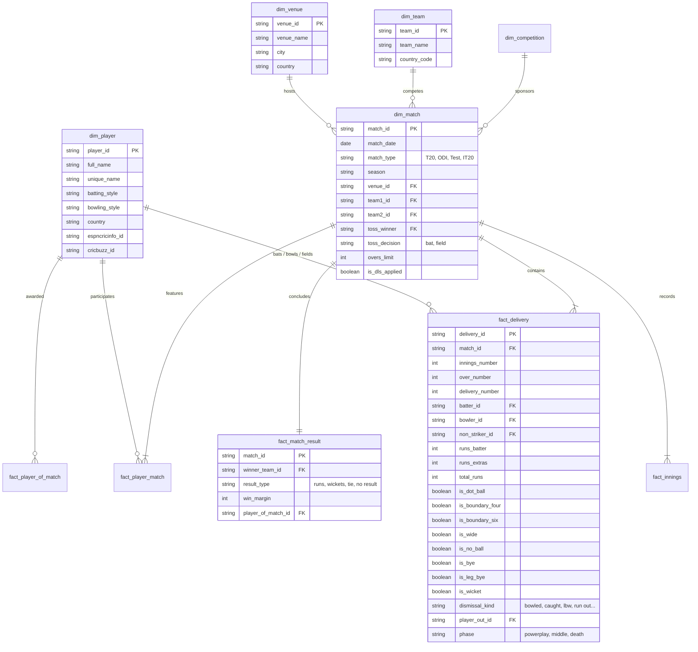

# 03 — Dimensional Data Model & Table Contracts

> **Architecture Style**: Star Schema (Kimball Methodology) optimized for Vectorized In-Memory OLAP (DuckDB) & Fast AI Agent Ingestion.

---

## 1. Entity-Relationship Star Schema Diagram



---

## 2. Table DDL Contracts & Grain Definitions

### 2.1 Dimensions

#### `gold.dim_player`
- **Grain**: Exactly 1 row per unique cricket player in history.
```sql
CREATE TABLE gold.dim_player (
    player_id         VARCHAR(64) PRIMARY KEY,
    full_name         VARCHAR(128) NOT NULL,
    unique_name       VARCHAR(128) NOT NULL,
    cricsheet_key     VARCHAR(64) NOT NULL,
    batting_style     VARCHAR(64),
    bowling_style     VARCHAR(64),
    country           VARCHAR(64),
    espncricinfo_id   VARCHAR(64),
    cricbuzz_id       VARCHAR(64),
    created_at        TIMESTAMP DEFAULT CURRENT_TIMESTAMP
);
```

#### `gold.dim_match`
- **Grain**: Exactly 1 row per cricket match.
```sql
CREATE TABLE gold.dim_match (
    match_id          VARCHAR(64) PRIMARY KEY,
    match_date        DATE NOT NULL,
    match_type        VARCHAR(32) NOT NULL, -- 'T20', 'ODI', 'Test', 'IT20'
    gender            VARCHAR(16) NOT NULL, -- 'male', 'female'
    season            VARCHAR(16) NOT NULL,
    competition_id    VARCHAR(64),
    venue_id          VARCHAR(64) NOT NULL,
    team1_id          VARCHAR(64) NOT NULL,
    team2_id          VARCHAR(64) NOT NULL,
    toss_winner_id    VARCHAR(64) NOT NULL,
    toss_decision     VARCHAR(16) NOT NULL, -- 'bat', 'field'
    overs_limit       INTEGER,
    is_dls_applied    BOOLEAN DEFAULT FALSE
);
```

---

### 2.2 Fact Tables

#### `gold.fact_delivery` (The Atomic Core)
- **Grain**: Exactly 1 row per legal or extra delivery bowled.
```sql
CREATE TABLE gold.fact_delivery (
    delivery_id       VARCHAR(128) PRIMARY KEY, -- match_id_inn_over_ball
    match_id          VARCHAR(64) NOT NULL,
    innings_number    INTEGER NOT NULL,
    over_number       INTEGER NOT NULL,         -- 1 to 50
    delivery_number   INTEGER NOT NULL,         -- 1 to 10
    phase             VARCHAR(16) NOT NULL,     -- 'powerplay', 'middle', 'death'
    batter_id         VARCHAR(64) NOT NULL,
    bowler_id         VARCHAR(64) NOT NULL,
    non_striker_id    VARCHAR(64) NOT NULL,
    runs_batter       INTEGER NOT NULL,
    runs_extras       INTEGER NOT NULL,
    total_runs        INTEGER NOT NULL,
    is_dot_ball       BOOLEAN NOT NULL,
    is_boundary_four  BOOLEAN NOT NULL,
    is_boundary_six   BOOLEAN NOT NULL,
    is_wide           BOOLEAN NOT NULL,
    is_no_ball        BOOLEAN NOT NULL,
    is_bye            BOOLEAN NOT NULL,
    is_leg_bye        BOOLEAN NOT NULL,
    is_wicket         BOOLEAN NOT NULL,
    dismissal_kind    VARCHAR(32),              -- 'caught', 'bowled', 'lbw', 'stumped', 'run out'
    player_out_id     VARCHAR(64)
);
```

---

### 2.3 Curated Aggregation Marts (For AI Agents & Fast UI Lookups)

#### `gold.mart_player_batting_career`
```sql
CREATE TABLE gold.mart_player_batting_career AS
SELECT 
    p.player_id,
    p.full_name,
    m.match_type,
    COUNT(DISTINCT fd.match_id) AS matches_played,
    COUNT(DISTINCT CASE WHEN fd.innings_number IN (1,2) THEN fd.match_id END) AS innings_batted,
    SUM(fd.runs_batter) AS total_runs,
    COUNT(CASE WHEN fd.is_wide = FALSE THEN 1 END) AS balls_faced,
    COUNT(CASE WHEN fd.is_wicket AND fd.player_out_id = p.player_id THEN 1 END) AS dismissals,
    ROUND((SUM(fd.runs_batter)::DOUBLE / NULLIF(COUNT(CASE WHEN fd.is_wicket AND fd.player_out_id = p.player_id THEN 1 END), 0)), 2) AS batting_average,
    ROUND((SUM(fd.runs_batter)::DOUBLE / NULLIF(COUNT(CASE WHEN fd.is_wide = FALSE THEN 1 END), 0)) * 100, 2) AS strike_rate,
    SUM(CASE WHEN fd.is_boundary_four THEN 1 ELSE 0 END) AS fours,
    SUM(CASE WHEN fd.is_boundary_six THEN 1 ELSE 0 END) AS sixes,
    ROUND((COUNT(CASE WHEN fd.runs_batter = 0 AND fd.is_wide = FALSE THEN 1 END)::DOUBLE / NULLIF(COUNT(CASE WHEN fd.is_wide = FALSE THEN 1 END), 0)) * 100, 2) AS dot_ball_percentage
FROM gold.fact_delivery fd
JOIN gold.dim_player p ON fd.batter_id = p.player_id
JOIN gold.dim_match m ON fd.match_id = m.match_id
GROUP BY 1, 2, 3;
```

#### `gold.mart_player_matchup_matrix` (Tactical Batter vs Bowler Mart)
```sql
CREATE TABLE gold.mart_player_matchup_matrix AS
SELECT 
    bat.player_id AS batter_id,
    bat.full_name AS batter_name,
    bowl.player_id AS bowler_id,
    bowl.full_name AS bowler_name,
    bowl.bowling_style,
    fd.phase,
    COUNT(CASE WHEN fd.is_wide = FALSE THEN 1 END) AS balls_faced,
    SUM(fd.runs_batter) AS runs_scored,
    COUNT(CASE WHEN fd.is_wicket AND fd.player_out_id = bat.player_id THEN 1 END) AS times_dismissed,
    ROUND((SUM(fd.runs_batter)::DOUBLE / NULLIF(COUNT(CASE WHEN fd.is_wide = FALSE THEN 1 END), 0)) * 100, 2) AS strike_rate,
    COUNT(CASE WHEN fd.runs_batter = 0 THEN 1 END) AS dot_balls
FROM gold.fact_delivery fd
JOIN gold.dim_player bat ON fd.batter_id = bat.player_id
JOIN gold.dim_player bowl ON fd.bowler_id = bowl.player_id
GROUP BY 1, 2, 3, 4, 5, 6;
```
