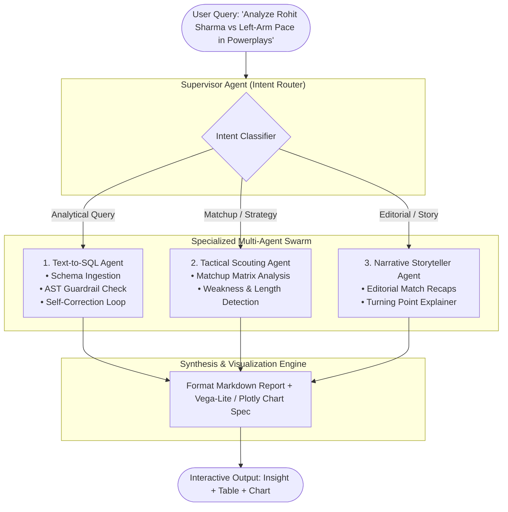
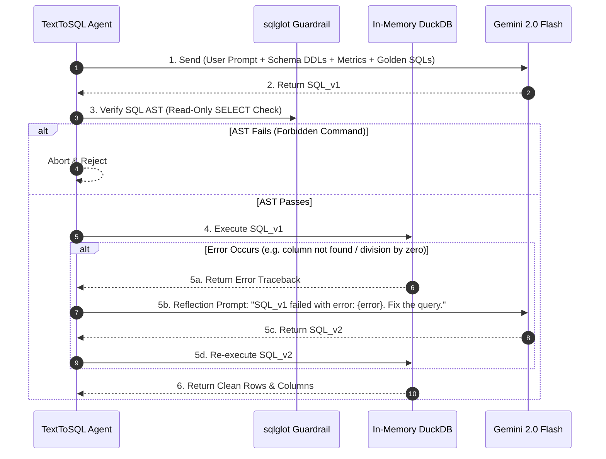

# 05 — Generative AI & Multi-Agent Intelligence Engine

> **Core Engine**: Gemini 2.0 Flash / Pro + LangGraph + `sqlglot` AST Guardrails + In-Memory DuckDB

---

## 1. Multi-Agent Swarm Architecture

The Generative Intelligence layer is orchestrated by a **Supervisor Agent** that categorizes user queries and routes them to specialized, purpose-built subagents:



---

## 2. Agent 1: Analytical Text-to-SQL ("Data Sensei")

### 2.1 The Self-Correction Reflection Loop
If an LLM produces a syntax error or references a non-existent column, the engine does not fail to the user. Instead, it enters an autonomous **3-Turn Reflection Loop**:



### 2.2 SQL AST Guardrail Validator (`sqlglot`)
```python
import sqlglot
from sqlglot import exp


class SQLSecurityGuardrail:
    ALLOWED_TABLES = {
        "gold.dim_player",
        "gold.dim_match",
        "gold.dim_venue",
        "gold.dim_team",
        "gold.fact_delivery",
        "gold.fact_innings",
        "gold.fact_match_result",
        "gold.fact_player_match",
        "gold.fact_player_of_match",
        "gold.mart_player_batting_career",
        "gold.mart_player_bowling_career",
        "gold.mart_player_matchup_matrix",
    }

    @classmethod
    def validate_sql(cls, sql_text: str) -> tuple[bool, str]:
        try:
            parsed = sqlglot.parse_one(sql_text, read="duckdb")
        except Exception as e:
            return False, f"SQL Syntax Parsing Error: {str(e)}"

        # 1. Must be strictly a SELECT or WITH expression
        if not isinstance(parsed, (exp.Select, exp.Union)):
            return False, "Security Error: Only SELECT queries are permitted."

        # 2. Block all destructive / administrative statements
        forbidden_types = (
            exp.Drop,
            exp.Delete,
            exp.Insert,
            exp.Update,
            exp.Alter,
            exp.Create,
            exp.Command,
            exp.Pragma,
        )
        if any(parsed.find(f_type) for f_type in forbidden_types):
            return False, "Security Error: Destructive statements are strictly forbidden."

        # 3. Restrict tables to gold.* schema
        tables = [t.name.lower() for t in parsed.find_all(exp.Table)]
        for t in tables:
            if not any(t == allowed.split(".")[-1] for allowed in cls.ALLOWED_TABLES):
                return False, f"Security Error: Table '{t}' is not an authorized Gold table."

        return True, "SQL is Valid and Safe"
```

---

## 3. Agent 2: Tactical Scouting & Matchup Strategist

- **Task**: Provides deep match tactical previews and bowler-batter matchups.
- **Workflow**:
  1. Identifies opposing batters and bowlers from the user prompt.
  2. Queries `gold.mart_player_matchup_matrix` for historical head-to-head records across Powerplay, Middle, and Death phases.
  3. Formulates tactical recommendations (e.g. *"Bowl left-arm orthodox spin in overs 1–6 against Batter X; his strike rate drops to 94.2 with a 38% dot ball frequency"*).

---

## 4. Agent 3: Narrative Storyteller & Commentary Synthesizer

- **Task**: Takes structured match delivery facts and generates engaging, journalistic match recaps.
- **Key Capabilities**:
  - Highlights turning point overs (where win probability shifted by >25%).
  - Spotlights clutch death-over batting or bowling spells.
  - Automatically formats the response with an embedded **Vega-Lite / Plotly Chart JSON** spec for instant rendering in the React frontend.
