# 🏏 CricPulse — Next-Gen Cricket Lakehouse & Generative Multi-Agent Platform

> **Tagline**: *Real-Time Telemetry, Delivery-Grain Lakehouse & Generative Intelligence for Cricket*  
> **Target Environment**: Google Cloud Platform (GCP Serverless) / 100% Decoupled Architecture  
> **Cost Profile**: Scale-to-Zero Compute ($0 to $3 / month)

---

## 📌 Executive Summary

**CricPulse** is an open-source, serverless data lakehouse and generative intelligence platform engineered to ingest, normalize, model, and serve 21,000+ historical cricket matches, ball-by-ball deliveries, and player registries from [Cricsheet](https://cricsheet.org). 

This redesigned architecture addresses the limitations of monolithic, heavy data stacks by cleanly separating the platform into **three independent, failure-isolated subsystems** communicating over an **Immutable Object Storage Data Bus (GCS / Parquet / DuckDB)**:

1. **Subsystem 1: Headless & Ephemeral DE Ingestion Pipeline** (Polars + DuckDB Python)
2. **Subsystem 2: AI-Ready Data Preparation & Semantic Layer** (YAML Metrics + Entity Resolution + Schema Annotator)
3. **Subsystem 3: Generative Multi-Agent Intelligence Engine** (FastAPI `cricket-api` + Gemini 2.0 Flash + Text-to-SQL with AST Guardrails)

---

## 🏛️ High-Level System Architecture

```mermaid
flowchart TD
    %% STORAGE & DATA BUS
    subgraph StorageBus["SHARED IMMUTABLE DATA BUS (Google Cloud Storage - gs://kaizencodes-cricket-data/)"]
        Raw["raw/ (Cricsheet JSONs & Register CSVs)"]
        Parquet["curated/parquet/ (Partitioned Silver/Gold Parquets)"]
        DuckDBSnap["published/cricket_latest.duckdb (Zero-Lock Serving DB)"]
        SemCatalog["metadata/semantic_catalog.yaml (Metric Definitions & DDLs)"]
    end

    %% SUBSYSTEM 1: DE PIPELINE
    subgraph Subsystem1["SUBSYSTEM 1: DE INGESTION PIPELINE (Headless Cloud Run Job / Actions)"]
        direction TB
        Trigger["Cloud Scheduler (Daily 02:00 UTC)"]
        Runner["Polars Delta Sync & Normalizer"]
        DQ["Data Quality & Schema Drift Gates"]
        
        Trigger --> Runner --> DQ
        DQ -->|Publish Artifacts| StorageBus
    end

    %% SUBSYSTEM 2: AI-READY PREPARATION
    subgraph Subsystem2["SUBSYSTEM 2: AI-READY SEMANTIC & METRIC LAYER"]
        direction TB
        Sem["YAML Metric Store (Strike Rate, Economy, Dot %, Clutch Index)"]
        Crosswalk["Entity Resolution (V Kohli ◄► Virat Kohli ◄► ESPNcricinfo)"]
        GoldenSQL["Few-Shot DDL & Golden Query Store"]
        
        StorageBus --> Sem & Crosswalk & GoldenSQL
    end

    %% SUBSYSTEM 3: GEN AI MICROSERVICE
    subgraph Subsystem3["SUBSYSTEM 3: GENERATIVE AI MICROSERVICE (Cloud Run: cricket-api)"]
        direction TB
        API["FastAPI Gateway (Scales 0 → 10 Nodes)"]
        
        subgraph Agents["Multi-Agent Swarm (LangGraph / Gemini 2.0 Flash)"]
            A1["Text-to-SQL Agent (sqlglot AST Guardrails)"]
            A2["Tactical Scouting & Matchup Agent"]
            A3["Narrative Storyteller Agent"]
        end
        
        MemDB["In-Memory DuckDB Engine"]
        
        API --> Agents
        Agents <--> Sem & Crosswalk & GoldenSQL
        Agents <--> MemDB
        MemDB -.->|Read Snapshot| StorageBus
    end

    %% CLIENT / CONSUMPTION
    subgraph Client["CONSUMPTION & CLIENTS"]
        WebUI["KaizenCodes Next.js Web App (/cricket)"]
        BI["Metabase / DuckDB Web UI"]
    end

    WebUI -->|HTTPS / WSS| API
    StorageBus -.->|Direct Read| BI
```

---

## 📑 Design Document Index

| Document | Title & Scope | Key Topics Covered |
| :--- | :--- | :--- |
| [`01_SYSTEM_ARCHITECTURE.md`](./01_SYSTEM_ARCHITECTURE.md) | **End-to-End System Architecture** | Decoupling strategy, microservice boundaries, failure isolation, sequence diagrams. |
| [`02_DATA_ENGINEERING_PIPELINE.md`](./02_DATA_ENGINEERING_PIPELINE.md) | **Data Engineering & Lakehouse Pipeline** | Cricsheet extraction, Polars normalization, revision ledger, idempotency, Parquet layouts. |
| [`03_DATA_MODEL_AND_CONTRACTS.md`](./03_DATA_MODEL_AND_CONTRACTS.md) | **Dimensional Data Model & Contracts** | Star schema (6 Dims, 5 Facts, 7 Marts), Mermaid ERDs, multi-wicket grain rules. |
| [`04_AI_READY_SEMANTIC_LAYER.md`](./04_AI_READY_SEMANTIC_LAYER.md) | **AI-Ready Semantic & Metric Layer** | Canonical YAML metrics, entity resolution crosswalk, schema catalog & Golden SQLs. |
| [`05_GENERATIVE_AI_MULTI_AGENTS.md`](./05_GENERATIVE_AI_MULTI_AGENTS.md) | **Generative AI & Multi-Agent Engine** | Text-to-SQL agent, SQL AST guardrails, self-correction reflection loops, tactical scouting. |
| [`06_GCP_SERVERLESS_DEPLOYMENT_PLAN.md`](./06_GCP_SERVERLESS_DEPLOYMENT_PLAN.md) | **GCP Serverless Deployment & Hosting** | Cloud Run `cricket-api`, GCS, Cloud Scheduler, Scale-to-Zero, monthly cost review ($0–$3/mo). |
| [`07_API_AND_INTEGRATION_SPEC.md`](./07_API_AND_INTEGRATION_SPEC.md) | **API & Frontend Integration Specs** | OpenAPI specifications, `/api/v1/analytics/*`, `/api/v1/ai/*`, Next.js React integration. |

---

## 🎯 Key Architectural Differentiators

1. **True Scale-to-Zero ($0.00 Idle Cost)**: Eliminates 24/7 idle infrastructure (MWAA Airflow, dedicated database clusters, always-on Spark nodes).
2. **Zero Database Lock Conflicts**: Each subsystem operates on immutable DuckDB/Parquet snapshots or in-memory instances.
3. **Deterministic AI Analytics**: LLMs never guess math or query raw files; queries pass through AST security guardrails and canonical YAML business formulas.
4. **Instant Sub-50ms Analytical Queries**: In-memory DuckDB queries 21,000+ matches in milliseconds.
