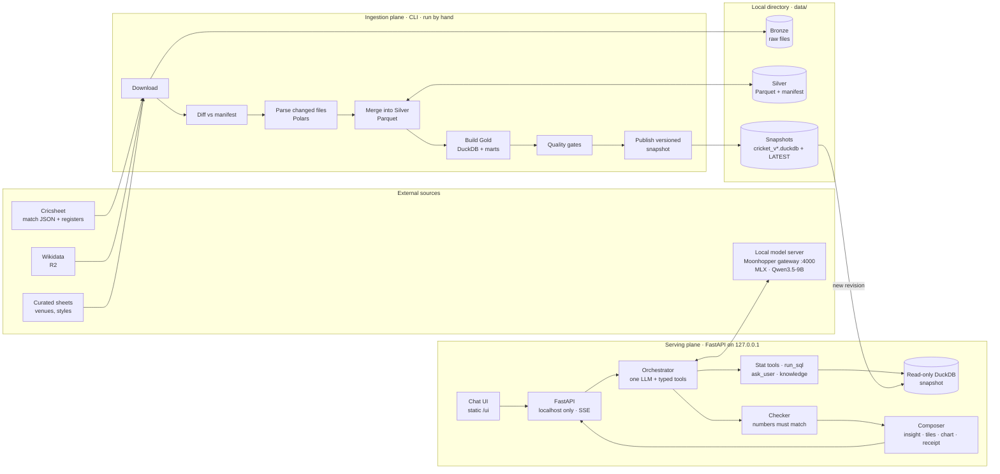
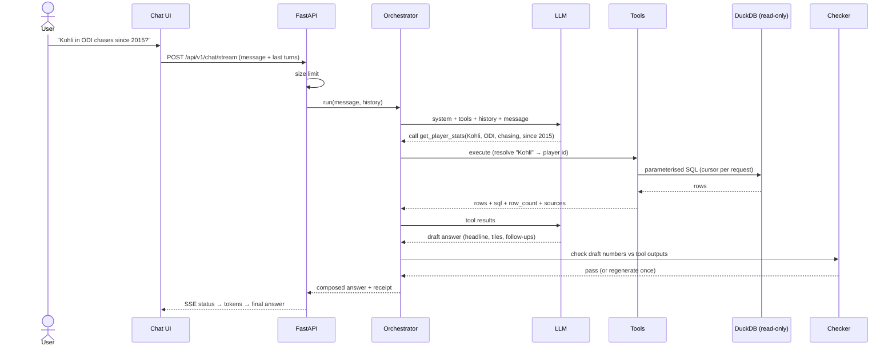
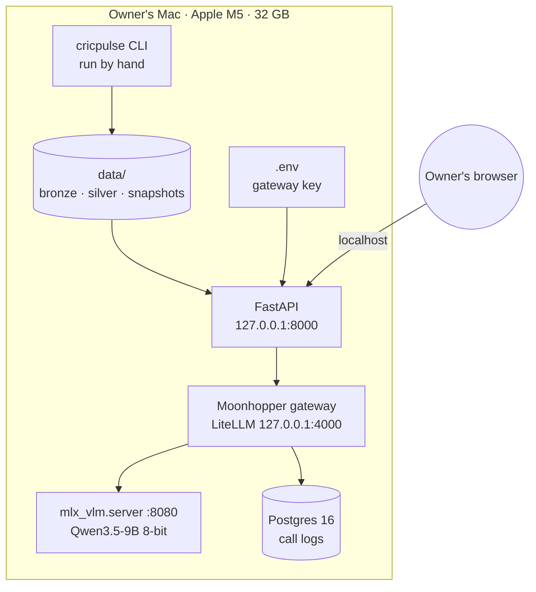

# CricPulse — High-Level Design

**Status:** Draft v0.1 · **Date:** 26 Oct 2026 · **Revised:** 17 Nov 2026 (personal, local, open source)
**Input:** `01_PRODUCT_REQUIREMENT_DOCUMENT.md` (D-1 … D-5 taken at the recommended values)
**Next:** `03_LOW_LEVEL_DESIGN.md` → `04_IMPLEMENTATION_PLAN.md`

---

## 0. About This Document

This document says **how the system is shaped**: its parts, how they talk, where data lives,
and the big decisions. The LLD goes one level down, to files, functions and schemas.

Since 17 Nov 2026 CricPulse is a personal tool on the owner's Mac. It uses no paid service and no Google Cloud.
ADR status: **Proposed** = recommended, needs the owner's OK · **Accepted** = owner agreed.

---

## 1. Architecture at a Glance



**In one line:** a command run by hand turns raw cricket files into an immutable, versioned DuckDB snapshot.
A stateless chat service on `127.0.0.1` answers questions by calling typed tools over that snapshot. A checker
rejects any number the tools did not return.

---

## 2. Subsystems

| # | Subsystem | Responsibility | Code today | Changes |
|---|---|---|---|---|
| 1 | **Ingestion job** | Download, parse, build, check, publish | `src/downloaders`, `src/parsers`, `src/builder`, `src/publisher` | Runs as a job, not inside the API. Silver persisted. Full rebuild. Versioned publish. |
| 2 | **Data store** | Bronze, Silver, Gold snapshots | Local `data/` only | Same layout, local `data/` only. *Superseded 17 Nov 2026: local `data/` only — instead of a cloud bucket, because there is one machine.* |
| 3 | **Semantic layer** | Metric formulas, dimensions, entity resolution | `conf/semantic_catalog.yaml`, `src/semantic` | Stays the single home for formulas |
| 4 | **AI service** | Orchestrator, tools, checker, composer | `src/ai` (supervisor + 3 agents) | Supervisor + regex router replaced by one orchestrator with tools |
| 5 | **API** | HTTP, streaming | `src/api` | Chat + stream endpoints; sync endpoint removed; binds `127.0.0.1` |
| 6 | **Chat UI** | One screen, one chat box | `src/api/static/index.html` | Streaming, receipts, history |
| 7 | **Ops** | CI/CD, scheduling, logs, evaluations | `.github/workflows`, `scripts` | Eval gate, traces |

---

## 3. Runtime Flow — One Question



Rules:
- At most **4 tool rounds** per question. Tools run in parallel when the model asks for several.
- **`run_sql` gets one repair retry**, not three.
- **Ambiguity → `ask_user`** (a clarifying question with options), never a guess.
- The **server keeps no session**. The UI sends the last few turns and the resolved subjects.

---

## 4. Data Flow — Data Refresh

```mermaid
sequenceDiagram
    participant OWN as Owner
    participant J as Ingest CLI
    participant D as data/ directory

    OWN->>J: cricpulse run (by hand; a launchd job may come later)
    J->>D: save raw archive to bronze/
    J->>D: read manifest (match_id → sha256)
    J->>J: parse only changed files (bad file → quarantine, job continues)
    J->>D: write merged Silver Parquet + new manifest
    J->>J: build Gold from ALL Silver → marts
    J->>J: quality gates (incl. "never shrinks")
    alt gates pass
        J->>D: write snapshots/cricket_v<id>.duckdb
        J->>D: write snapshots/LATEST.json (atomic rename)
        Note over D: the API reads the new snapshot at its next start
    else gates fail
        J->>J: stop — LATEST untouched, live data unchanged
    end
```

This removes all three blocking bugs from 08 §9:
1. **Delta wipes the corpus** → Gold is always rebuilt from all of Silver.
2. **Overwrite under live readers** → snapshots are never overwritten; a new one means a new revision.
3. **Empty, open deploy** → the API refuses to start without a snapshot, and listens on `127.0.0.1` only.

---

## 5. Data Architecture

### 5.1 Layers

| Layer | What | Format | Lifetime |
|---|---|---|---|
| **Bronze** | Raw Cricsheet archives, register CSVs, curated sheets | As downloaded | Keep 30 days + the last full archive |
| **Silver** | Parsed, normalised rows per table; manifest of parsed files | Parquet, one file per table | Rewritten each run by merge |
| **Gold** | Star schema + marts + `snapshot_info` | One DuckDB file per publish | Keep last 7 versions |

### 5.2 Storage layout (the local `data/` directory)

```
bronze/cricsheet/<date>/<archive>.zip
bronze/registers/<date>/{people,names}.csv
bronze/curated/{venues,styles}.csv
silver/<table>.parquet               # dim_match, fact_delivery, fact_innings, …
silver/manifest.parquet              # match_id, sha256, revision, parser_version, run_id
snapshots/cricket_v<YYYYMMDD>_<run>.duckdb
snapshots/LATEST.json                # version, path, sha256, counts, data cutoff
```

### 5.3 Gold model (summary — full columns in the LLD)
- **Dimensions:** `dim_player`, `dim_team`, `dim_venue` (stable curated ids), `dim_match` (+ event, stage), `player_aliases`, `player_identifiers`, `venue_aliases`.
- **Facts:** `fact_delivery` (+ `is_super_over`), `fact_innings`, `fact_wicket_detail`, `fact_player_match`.
- **Marts:** batting and bowling careers, matchup matrix; later phase splits, venue baselines, style matchups.
- **`snapshot_info`:** version, data cutoff date, counts. Feeds every receipt.

### 5.4 Data rules
- Formulas live **only** in `conf/semantic_catalog.yaml`. Tables store facts, not derived metrics.
- Super-over balls are flagged and kept out of normal innings stats.
- "Retired hurt" and "retired not out" never count as dismissals.
- The table allowlist for `run_sql` is generated from the snapshot's `gold` schema, not hardcoded.

---

## 6. AI Architecture

### 6.1 Pattern: one orchestrator, typed tools, a checker (from 08 §5)

```
                 ┌────────────── Orchestrator (one LLM) ──────────────┐
 question ─────▶ │ plan → call tools (parallel) → draft → check → done │ ─────▶ answer
                 └────────┬─────────────────┬────────────────┬────────┘
                          ▼                 ▼                ▼
                 Tier 1: stat tools   Tier 2: run_sql   Tier 3: knowledge (R3)
                 (curated, typed)     (guarded, 1 retry) (cited search, rules)
                          + ask_user (clarify) — replaces the regex Clarifier paths
```

- **Tier 1 — curated stat tools.** Player stats, compare, leaderboard, matchup, phase splits, venue
  profile, team head-to-head, match summary. Built from today's golden queries, scout and storyteller code.
- **Tier 2 — `run_sql`.** The long tail. AST-guarded, read-only, row-limited, timed out.
- **Tier 3 — knowledge (R3).** `search_knowledge`, `explain_rule`; optional `web_search` (R3).
- **Checker.** Every number in the reply must appear in a tool output. One regeneration, then a
  numbers-only fallback.
- **Composer.** Turns the checked draft into the answer anatomy: insight, tiles, chart, table,
  receipt, follow-ups. Reuses `ChartSpecGenerator`.

### 6.2 Model choice
- **Runtime:** the owner's Moonhopper gateway. LiteLLM (`127.0.0.1:4000`, MIT) forwards to `mlx_vlm.server` (`:8080`, MIT) on Metal. CricPulse calls the OpenAI-style API at `http://127.0.0.1:4000/v1` with the model name `cricpulse-local`. That name has **no cloud fallback**. The model is a config value per role (`llm_base_url`, `llm_model`, `llm_api_key`).
- **The evaluation set picks the model:** the one that answers the most of the 26 review questions right, fast enough (full answer ≤ 30 s).
- **Start with** Qwen3.5-9B (Apache 2.0), 8-bit MLX, about 10 GB. It is already downloaded and passed the tool-call test on 17 Nov 2026.
- **Challenger (M2):** a bigger MLX model, such as a 30B-class mixture of experts at 4-bit (about 20 GB).
- **Small models guess.** In the test it assumed "Test" for "Smith's average". So ambiguity is enforced by the tools: a missing format returns "ask the user".
- *Superseded 17 Nov 2026 (ADR-7): a local model on Moonhopper — instead of a paid gateway with Claude and Gemini candidates, because the owner wants no paid service and nothing leaving the laptop.*

---

## 7. Local Topology



- **Same codebase, two entry points:** the API (`bash scripts/run_local.sh`) and the ingest CLI.
- **Start order:** `make start` in Moonhopper, then the app. With no internet the app still answers.
- **Snapshot delivery:** the API reads `data/` through `LATEST.json`. No image, no deploy step.
- **Memory budget:** the 8-bit model takes about 10 GB. The DuckDB snapshot, Docker and a browser share the rest of 32 GB.
- *Superseded 17 Nov 2026 (ADR-2, ADR-4): a local topology on one Mac — instead of a Google Cloud topology (a cloud job, a bucket, a cloud service and a scheduler), because the owner is the only user and there is one machine.*

---

## 8. Security Architecture

| Threat | Control |
|---|---|
| Other devices reach the app or the model server | The app binds `127.0.0.1` only. The gateway is local. Check that `mlx_vlm.server` does not listen on `0.0.0.0:8080`. |
| SQL reads files or the network | DuckDB `enable_external_access=false` + `lock_configuration=true`; function denylist in the guard |
| SQL writes or escapes the schema | `read_only=True`; AST allows one `SELECT`/`WITH` over `gold.*` only (the guard) |
| Expensive queries | `LIMIT 500` injected; 5 s timeout via interrupt; memory limit |
| Prompt injection from web/knowledge text | Tool output is data; no tool can act on the outside world; topic guard |
| Secrets leak | Only the gateway's local key, in `.env`; never in code, logs or commits |

Rate limits, a spend cap and CORS work are parked with the public launch (17 Nov 2026).

---

## 9. Memory and Latency Budget (checked 17 Nov 2026 on an Apple M5, 32 GB, 100 GB free disk)

| Item | Budget | Note |
|---|---|---|
| Money | No paid service | Local model; no per-answer cost |
| Model memory | About 10 GB | Qwen3.5-9B, 8-bit. A 30B-class 4-bit challenger needs about 20 GB. |
| Rest of memory | About 20 GB for the OS, DuckDB, Docker and a browser | Measure in M2 before the challenger runs |
| Step latency | 4–8 s per model step | Seen in the 17 Nov test |
| Full answer | ≤ 30 s | A 3–4 step answer takes 15–30 s |

*Superseded 17 Nov 2026: a memory and latency budget — instead of a ₹1,000 monthly cost model, because local models cost nothing per answer.*

---

## 10. Observability & Quality

- **One trace record per answer:** request id, tools called, SQL, rows, tokens, latency,
  checker result, model, snapshot version. Written to a local file (`structlog`, as today).
- **Model calls** are logged by Moonhopper's LiteLLM gateway in its Postgres 16 (tokens, latency, full prompt; dashboard at `:4000/ui`). No separate tracing server.
- **Evaluation set** (`evals/questions.yaml`): question + expected numbers from independent SQL.
  Runs in CI with a mock model, and live against the local model before each module is sealed. The gate: no regression.
- **Quality gates** on every publish: row counts, null rates, no duplicate keys, never shrinks.

---

## 11. Failure Modes

| Failure | What the user sees | Recovery |
|---|---|---|
| Ingest job fails or gates fail | Yesterday's data; cutoff date says so | Fix; re-run job |
| One bad match file | Nothing | Quarantined; alert in logs |
| Local model not running | "Local model not running — run `make start` in Moonhopper" | Start the gateway |
| Tool SQL times out | Clarifying question or "too broad" | Narrower question |
| Model load after a start | First answer slower | Accepted; one user |

---

## 12. Architecture Decision Records

| ADR | Decision | Why | Status |
|---|---|---|---|
| ADR-1 | **Keep DuckDB snapshots** as the serving store (not Postgres) | DuckDB is built, fast and local; 08's DuckDB non-negotiables are adopted | **Accepted** 26 Oct |
| ADR-2 | Ingestion runs as a separate job; the API never writes data. *Superseded 17 Nov 2026: the job is the `cricpulse` CLI, run by hand — instead of a cloud job, because there is one machine and no cloud.* | Removes OOM, timeouts and the hot-swap bug | **Superseded** 17 Nov |
| ADR-3 | **Immutable versioned snapshots**; a new snapshot = a new revision; no in-process swap | Atomic by construction | Proposed |
| ADR-4 | Snapshot delivery: bake into the API image at publish. *Superseded 17 Nov 2026: the API reads `data/` through `LATEST.json` — instead of an image or a cloud volume, because no deploy step exists.* | No download at start | **Superseded** 17 Nov |
| ADR-5 | **One orchestrator + typed tools + checker**; Scout and Storyteller become tools | 08 §5; fewer hops, cost, latency | Proposed |
| ADR-6 | Agent framework: **PydanticAI** | Typed tools from Pydantic models, streaming, provider-neutral, test models; fallback: a ~150-line custom loop | **Accepted** 26 Oct |
| ADR-7 | A paid gateway, model chosen by the evaluation set. *Superseded 17 Nov 2026: the Moonhopper gateway with the local model `cricpulse-local` — instead of a paid gateway, because the owner wants no paid service.* The evaluation set still picks the model. | Local, free, logs every call | **Superseded** 17 Nov |
| ADR-8 | **Keep the static chat UI** at `/ui`; add SSE | Chat-only product; no second app to run | Proposed |
| ADR-9 | **Stateless server**; the UI sends recent turns | No session store needed | Proposed |
| ADR-10 | Silver as **Parquet + manifest** replaces the SQLite ledger | The ledger lived on ephemeral disk and lost state | Proposed |
| ADR-11 | **Python 3.12 + `uv` lockfile** across Docker and CI | One reproducible environment | Proposed |

---

## 13. PRD Coverage

| PRD item | Where it lives |
|---|---|
| FR-1, FR-7, FR-8, FR-9, FR-10 | Tier 1 tools over Gold + marts |
| FR-2, TR-8 | Composer receipt + `snapshot_info` |
| FR-3 | `ask_user` tool |
| FR-4, FR-5, FR-6 | UI history, follow-ups, SSE |
| FR-11, FR-12 | Tier 3 knowledge; checker on translated numbers |
| FR-13, FR-14 | R4 tools + models (later HLD revision) |
| TR-1 | Checker |
| TR-2, TR-3 | §8 controls |
| TR-4 … TR-7 | Parser + catalog rules (§5.4) |
| TR-9 | Job + gates + immutable snapshots (§4) |
| NFR cost | §9 (memory and latency budget) |

---

## Appendix A — Open Technical Items

| # | Item | Resolve in |
|---|---|---|
| T-1 | Full snapshot size (estimate 0.5–1.5 GB; only partial builds on disk today) | M0b |
| T-2 | *Superseded 17 Nov 2026: closed — there is no image or cloud instance* | — |
| T-3 | Can DuckDB extensions (e.g. full-text search) load with external access off? Pre-install at build time | M8 |
| T-4 | A source of upcoming fixtures for match previews | M11 |
