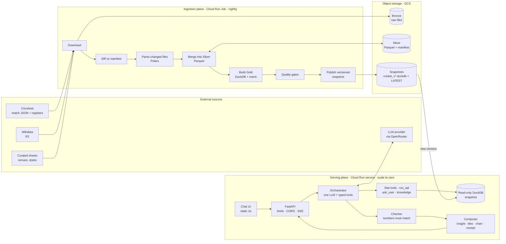
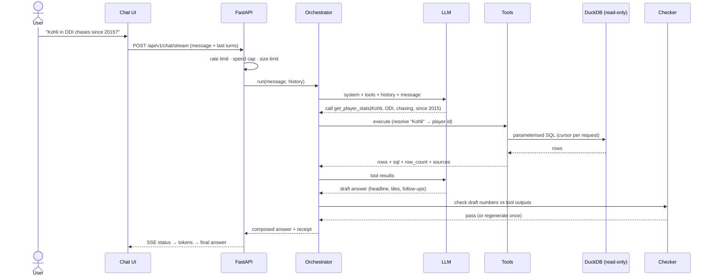
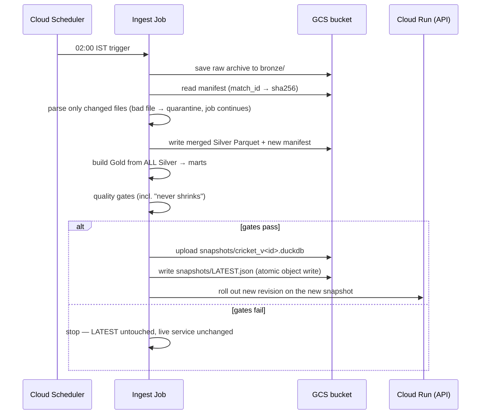
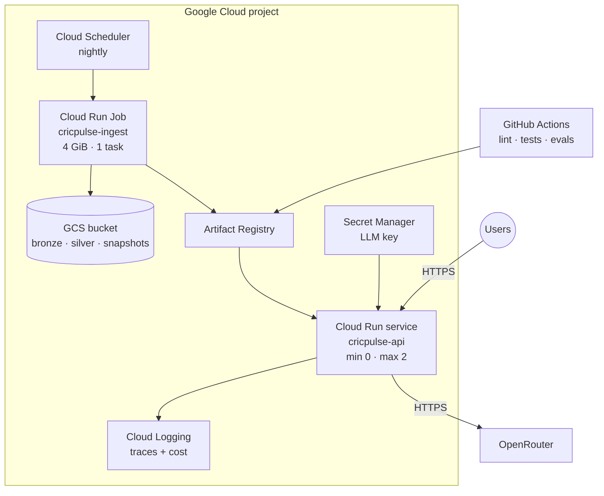

# CricPulse — High-Level Design

**Status:** Draft v0.1 · **Date:** 26 Oct 2026
**Input:** `01_PRODUCT_REQUIREMENT_DOCUMENT.md` (D-1 … D-5 taken at the recommended values)
**Next:** `03_LOW_LEVEL_DESIGN.md` → `04_IMPLEMENTATION_PLAN.md`

---

## 0. About This Document

This document says **how the system is shaped**: its parts, how they talk, where data lives,
and the big decisions. The LLD goes one level down, to files, functions and schemas.

ADR status: **Proposed** = recommended, needs the owner's OK · **Accepted** = owner agreed.

---

## 1. Architecture at a Glance



**In one line:** a nightly job turns raw cricket files into an immutable, versioned DuckDB snapshot.
A stateless chat service answers questions by calling typed tools over that snapshot. A checker
rejects any number the tools did not return.

---

## 2. Subsystems

| # | Subsystem | Responsibility | Code today | Changes |
|---|---|---|---|---|
| 1 | **Ingestion job** | Download, parse, build, check, publish | `src/downloaders`, `src/parsers`, `src/builder`, `src/publisher` | Runs as a job, not inside the API. Silver persisted. Full rebuild. Versioned publish. |
| 2 | **Data store** | Bronze, Silver, Gold snapshots | Local `data/` only | GCS bucket with the same layout; local dir for dev |
| 3 | **Semantic layer** | Metric formulas, dimensions, entity resolution | `conf/semantic_catalog.yaml`, `src/semantic` | Stays the single home for formulas |
| 4 | **AI service** | Orchestrator, tools, checker, composer | `src/ai` (supervisor + 3 agents) | Supervisor + regex router replaced by one orchestrator with tools |
| 5 | **API** | HTTP, streaming, limits | `src/api` | Chat + stream endpoints; sync endpoint removed |
| 6 | **Chat UI** | One screen, one chat box | `src/api/static/index.html` | Streaming, receipts, history |
| 7 | **Ops** | CI/CD, scheduling, logs, evaluations | `.github/workflows`, `scripts` | Job deploy, eval gate, traces |

---

## 3. Runtime Flow — One Question



Rules:
- At most **4 tool rounds** per question. Tools run in parallel when the model asks for several.
- **`run_sql` gets one repair retry**, not three.
- **Ambiguity → `ask_user`** (a clarifying question with options), never a guess.
- The **server keeps no session**. The UI sends the last few turns and the resolved subjects.

---

## 4. Data Flow — Nightly Update



This removes all three blocking bugs from 08 §9:
1. **Delta wipes the corpus** → Gold is always rebuilt from all of Silver.
2. **Overwrite under live readers** → snapshots are never overwritten; a new one means a new revision.
3. **Empty, open deploy** → the API refuses to start without a snapshot; limits and a spend cap guard the endpoint.

---

## 5. Data Architecture

### 5.1 Layers

| Layer | What | Format | Lifetime |
|---|---|---|---|
| **Bronze** | Raw Cricsheet archives, register CSVs, curated sheets | As downloaded | Keep 30 days + the last full archive |
| **Silver** | Parsed, normalised rows per table; manifest of parsed files | Parquet, one file per table | Rewritten each run by merge |
| **Gold** | Star schema + marts + `snapshot_info` | One DuckDB file per publish | Keep last 7 versions |

### 5.2 Storage layout (GCS bucket and local `data/` mirror it)

```
bronze/cricsheet/<date>/<archive>.zip
bronze/registers/<date>/{people,names}.csv
bronze/curated/{venues,styles}.csv
silver/<table>.parquet               # dim_match, fact_delivery, fact_innings, …
silver/manifest.parquet              # match_id, sha256, revision, parser_version, run_id
snapshots/cricket_v<YYYYMMDD>_<run>.duckdb
snapshots/LATEST.json                # version, path, sha256, counts, data cutoff
```

### 5.3 Gold model (summary — full columns in the LLD)
- **Dimensions:** `dim_player`, `dim_team`, `dim_venue` (stable curated ids), `dim_match` (+ event, stage), `player_aliases`, `player_identifiers`, `venue_aliases`.
- **Facts:** `fact_delivery` (+ `is_super_over`), `fact_innings`, `fact_wicket_detail`, `fact_player_match`.
- **Marts:** batting and bowling careers, matchup matrix; later phase splits, venue baselines, style matchups.
- **`snapshot_info`:** version, data cutoff date, counts. Feeds every receipt.

### 5.4 Data rules
- Formulas live **only** in `conf/semantic_catalog.yaml`. Tables store facts, not derived metrics.
- Super-over balls are flagged and kept out of normal innings stats.
- "Retired hurt" and "retired not out" never count as dismissals.
- The table allowlist for `run_sql` is generated from the snapshot's `gold` schema, not hardcoded.

---

## 6. AI Architecture

### 6.1 Pattern: one orchestrator, typed tools, a checker (from 08 §5)

```
                 ┌────────────── Orchestrator (one LLM) ──────────────┐
 question ─────▶ │ plan → call tools (parallel) → draft → check → done │ ─────▶ answer
                 └────────┬─────────────────┬────────────────┬────────┘
                          ▼                 ▼                ▼
                 Tier 1: stat tools   Tier 2: run_sql   Tier 3: knowledge (R3)
                 (curated, typed)     (guarded, 1 retry) (cited search, rules)
                          + ask_user (clarify) — replaces the regex Clarifier paths
```

- **Tier 1 — curated stat tools.** Player stats, compare, leaderboard, matchup, phase splits, venue
  profile, team head-to-head, match summary. Built from today's golden queries, scout and storyteller code.
- **Tier 2 — `run_sql`.** The long tail. AST-guarded, read-only, row-limited, timed out.
- **Tier 3 — knowledge (R3).** `search_knowledge`, `explain_rule`; optional `web_search` (R3).
- **Checker.** Every number in the reply must appear in a tool output. One regeneration, then a
  numbers-only fallback.
- **Composer.** Turns the checked draft into the answer anatomy: insight, tiles, chart, table,
  receipt, follow-ups. Reuses `ChartSpecGenerator`.

### 6.2 Model choice
- One provider gateway (OpenRouter, as today). The model is a config value per role.
- **The evaluation set picks the model:** the cheapest model that scores ≥ 90%.
- Candidates: Claude Haiku 5.5, Claude Sonnet 5.5, Gemini 2.5 Flash.
- Static prompt parts go first so the provider can cache them.

---

## 7. Deployment Topology (GCP)



- **Same codebase, two entry points:** `cricpulse-api` (service) and `cricpulse-ingest` (job).
- **Local dev:** `docker compose` runs the API on a local snapshot; the job runs as a CLI against `data/`.
- **Snapshot delivery to the API** is ADR-4 (decided by a measurement in M0b).

---

## 8. Security Architecture

| Threat | Control |
|---|---|
| SQL reads files or the network | DuckDB `enable_external_access=false` + `lock_configuration=true`; function denylist in the guard |
| SQL writes or escapes the schema | `read_only=True`; AST allows one `SELECT`/`WITH` over `gold.*` only |
| Expensive queries | `LIMIT 500` injected; 5 s timeout via interrupt; memory limit |
| Prompt injection from web/knowledge text | Tool output is data; no tool can act on the outside world; topic guard |
| Cost denial-of-service | Per-IP rate limits; daily spend cap in app; **hard monthly cap on the provider key** |
| Corrupt or empty data served | Immutable snapshots; quality gates; API refuses to start without a snapshot |
| Secrets leak | Secret Manager; nothing in the image; no default tokens in production |
| Cross-site abuse | CORS allowlist of the app's own origin; no credentials with wildcard origins |

---

## 9. Cost Model (estimate — check in M5 with real traces)

Assumes ~10k input and ~1.5k output tokens per answer (2–3 model calls, before caching).

| Item | Monthly estimate | Note |
|---|---|---|
| LLM on Claude Haiku 5.5 ($0.10 / $0.50 per M tokens) | ~$0.002 per answer → ~5,000 answers ≈ $10 | Fits the cap |
| LLM on Claude Sonnet 5.5 ($2 / $10 per M tokens) | ~$0.035 per answer → ~300 answers ≈ $10 | Too costly for public use |
| Cloud Run service + job | ≈ $0 | Free tier at beta traffic |
| GCS (~5 GB) | < $0.20 | |
| Artifact Registry, Scheduler, Secrets | ≈ $0 | Keep 3 images; 1 scheduler job |
| **Cap** | **₹1,000 ≈ $11** | Enforced by the provider key limit |

---

## 10. Observability & Quality

- **One trace record per answer:** request id, tools called, SQL, rows, tokens, cost, latency,
  checker result, model, snapshot version. Written as structured logs (`structlog`, as today).
- **Evaluation set** (`evals/questions.yaml`): question + expected numbers from independent SQL.
  Runs in CI with a mock model, and live before each release. Release gate: ≥ 90%.
- **Quality gates** on every publish: row counts, null rates, no duplicate keys, never shrinks.

---

## 11. Failure Modes

| Failure | What the user sees | Recovery |
|---|---|---|
| Ingest job fails or gates fail | Yesterday's data; cutoff date says so | Fix; re-run job |
| One bad match file | Nothing | Quarantined; alert in logs |
| LLM provider down or slow | "Can't answer right now" | One retry, then fail fast |
| Spend cap reached | "Daily limit reached, back tomorrow" | Resets daily |
| Tool SQL times out | Clarifying question or "too broad" | Narrower question |
| Cold start | First answer 3–8 s slower | Accepted at beta traffic |

---

## 12. Architecture Decision Records

| ADR | Decision | Why | Status |
|---|---|---|---|
| ADR-1 | **Keep DuckDB snapshots** as the serving store (not Postgres) | Always-on Postgres (~$10–15/mo) uses the whole ₹1,000 cap; DuckDB is built and fast; 08's DuckDB non-negotiables are adopted | **Accepted** 26 Oct |
| ADR-2 | Ingestion runs as a **Cloud Run Job**; the API never writes data | Removes OOM, timeouts and the hot-swap bug | Proposed |
| ADR-3 | **Immutable versioned snapshots**; a new snapshot = a new revision; no in-process swap | Atomic by construction | Proposed |
| ADR-4 | Snapshot delivery: **bake into the API image** at publish; fallback: GCS volume mount | No download at start; verify memory use in M0b | Proposed |
| ADR-5 | **One orchestrator + typed tools + checker**; Scout and Storyteller become tools | 08 §5; fewer hops, cost, latency | Proposed |
| ADR-6 | Agent framework: **PydanticAI** | Typed tools from Pydantic models, streaming, provider-neutral, test models; fallback: a ~150-line custom loop | **Accepted** 26 Oct |
| ADR-7 | **OpenRouter** gateway; model chosen by the evaluation set | One key, many models, key-level spend limit | Proposed |
| ADR-8 | **Keep the static chat UI** at `/ui`; add SSE | Chat-only product; no second app to run | Proposed |
| ADR-9 | **Stateless server**; the UI sends recent turns | No session store needed | Proposed |
| ADR-10 | Silver as **Parquet + manifest** replaces the SQLite ledger | The ledger lived on ephemeral disk and lost state | Proposed |
| ADR-11 | **Python 3.12 + `uv` lockfile** across Docker and CI | One reproducible environment | Proposed |

---

## 13. PRD Coverage

| PRD item | Where it lives |
|---|---|
| FR-1, FR-7, FR-8, FR-9, FR-10 | Tier 1 tools over Gold + marts |
| FR-2, TR-8 | Composer receipt + `snapshot_info` |
| FR-3 | `ask_user` tool |
| FR-4, FR-5, FR-6 | UI history, follow-ups, SSE |
| FR-11, FR-12 | Tier 3 knowledge; checker on translated numbers |
| FR-13, FR-14 | R4 tools + models (later HLD revision) |
| TR-1 | Checker |
| TR-2, TR-3 | §8 controls |
| TR-4 … TR-7 | Parser + catalog rules (§5.4) |
| TR-9 | Job + gates + immutable snapshots (§4) |
| NFR cost | §8, §9 |

---

## Appendix A — Open Technical Items

| # | Item | Resolve in |
|---|---|---|
| T-1 | Full snapshot size (estimate 0.5–1.5 GB; only partial builds on disk today) | M0b |
| T-2 | Does a file baked into the image count against Cloud Run instance memory? | M0b |
| T-3 | Can DuckDB extensions (e.g. full-text search) load with external access off? Pre-install at build time | M8 |
| T-4 | A source of upcoming fixtures for match previews | M11 |
