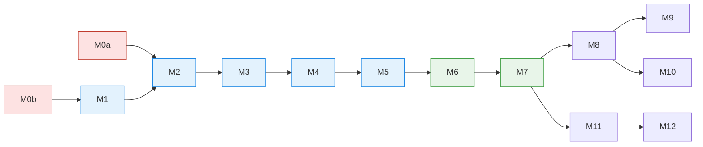

# CricPulse — Implementation Plan

**Status:** Draft v0.1 · **Date:** 26 Oct 2026
**Input:** `01_PRD` · `02_HLD` · `03_LLD`
**Same approach as HoppingCars:** modules in order, each planned in its own dossier, built
task by task, reviewed, tested, then **sealed** before the next one starts.

---

## 1. How a Module Moves

```
Pick ─▶ Deep dive (dossier) ─▶ Task cards ─▶ Build task by task ─▶ Review ─▶ UAT ─▶ Sealed
 you      me + you approve      me             build sessions       fresh     you     table §2
```

| Step | Output | Who |
|---|---|---|
| Deep dive | `docs/features/M<n>-<NAME>.md` — scope, decisions, design, risks | Planner (`plan` skill), owner approves |
| Task cards | `docs/features/M<n>-TASK-CARDS.md` — tasks M<n>.1, M<n>.2 … each with subtasks, owned files, Verify | Planner |
| Build | Code + tests, one task per session | Builder (`build` skill) |
| Test | Suite + evaluations green | `test` skill |
| Review | `docs/reviews/M<n>-REVIEW.md` | A fresh session |
| UAT | `docs/uat/M<n>-UAT.md` — scripted chat journeys | `uat` skill, owner signs |
| Land | Local commits on a `feat/M<n>-…` branch from GitHub's `dev`; one pull request per module | `kura`: commits, then pushes and opens the PR on the owner's yes; **the owner merges** in the GitHub web UI |

---

## 2. Module Roadmap

| Module | Name | Release | Goal (one line) | PRD items | Depends on | Status |
|---|---|---|---|---|---|---|
| **M0a** | Safe serving | R0 | The API cannot be tricked into reading files, injecting SQL, or serving an empty DB | TR-2 | — | Planned |
| **M0b** | Trustworthy data pipeline | R0 | Nightly job that never shrinks or corrupts the live data | TR-9 | ADR-1…4, 10 | **Deep dive** — `features/M0B-*` |
| **M1** | Cricket-correct data | R1 | Super overs, retirements, DLS, events, stable venues, `snapshot_info` | TR-4…8, FR-7 (data) | M0b | Planned |
| **M2** | Orchestrator & stat tools | R1 | One agent with typed tools answers stats questions; evaluation set v1 | FR-1, FR-3, FR-7, FR-8 | M1 | Planned |
| **M3** | Trust layer | R1 | Checker, receipts, honest "can't answer", topic guard | FR-2, TR-1, TR-3 | M2 | Planned |
| **M4** | Chat experience | R1 | Streaming, follow-up memory, answer card with receipt | FR-4, FR-5, FR-6 | M3 | Planned |
| **M5** | Launch guard & private beta | R1 | Rate limits, spend cap, traces, eval gate, beta deploy | NFR cost, quality | M4 | Planned |
| **M6** | People & playing styles | R2 | Player profiles; style matchups (licence settled, D-4) | FR-8 (style), FR-10 | M5 | Planned |
| **M7** | Venues, phases & public launch | R2 | Venue profiles, phase baselines, launch checklist | FR-9 | M6 | Planned |
| **M8** | Knowledge & rules | R3 | Cited answers on rules and history | FR-11 | M7 | Planned |
| **M9** | Hindi answers | R3 | Same answers in Hindi; checker covers it | FR-12 | M8 | Planned |
| **M10** | News search *(optional)* | R3 | Recent context with sources, nothing stored | — | M8 | Planned |
| **M11** | Match preview card | R4 | Pre-match card in chat | FR-13 | M7 | Planned |
| **M12** | Win probability & what-if | R4 | Live-state win model and simulator | FR-14 | M11 | Planned |



**M0a and M0b can run side by side**: they touch different files (API vs pipeline).

---

## 3. What Each Module Contains (first cut — the deep dive refines it)

### M0a — Safe serving
- Validate `sort_by` against an allowlist (`routes/analytics.py:35,77`).
- DuckDB settings: `enable_external_access=false`, `lock_configuration=true`, memory limit.
- Guard: function **allowlist**.
- Cursor per request; no connection swap while serving.
- No snapshot → refuse to start; honest `/ready`.
- CORS allowlist; no default secrets in production.
- Python 3.12 + `uv.lock` in Docker and CI.

### M0b — Trustworthy data pipeline
- `storage.py` (local + GCS).
- Manifest + Silver merge; quarantine bad files.
- Full Gold rebuild from Silver; never-shrinks gate.
- Versioned publish + `LATEST.json`.
- Cloud Run Job + Scheduler; remove `/internal/sync-daily` and the hot swap.
- Measure snapshot size; settle ADR-4 (bake into image vs volume mount).

### M1 — Cricket-correct data
- Parser: super overs, retirement kinds, events, venue aliases.
- Gold: new columns, `venue_aliases`, `snapshot_info`.
- Marts: dismissals and super-over exclusions.
- Catalog: `counts_as_dismissal`; table allowlist read from the schema.

### M2 — Orchestrator & stat tools
- `llm.py` (PydanticAI on OpenRouter), `orchestrator.py`, tool registry.
- Tier 1 tools + `run_sql` (one repair) + `ask_user`.
- `/api/v1/chat` (JSON).
- `evals/` with ~50 questions; pick the model.
- Retire supervisor, scout, storyteller and the regex router.

### M3 — Trust layer
- Checker + regeneration + numbers-only fallback.
- Composer with receipt; `/api/v1/meta`.
- "Can't answer" paths; betting/off-topic guard.

### M4 — Chat experience
- `/api/v1/chat/stream` (SSE).
- UI: answer card, receipt panel, clarifying options, history in `sessionStorage`, attribution footer.
- Remove the old `/ai/*` endpoints.

### M5 — Launch guard & private beta
- Rate limits, daily spend cap, provider key limit.
- Trace record + cost per answer.
- Eval gate in CI; live run before deploy.
- Private beta on Cloud Run.

### M6 – M12
Planned at their deep dive. Scope is in the roadmap table and the LLD tags.

---

## 4. Module Definition of Done

A module is **Sealed** only when every row holds:

| # | Gate | Evidence |
|---|---|---|
| 1 | Dossier approved | `docs/features/M<n>-*.md` |
| 2 | All task cards landed | commits on the module branch |
| 3 | `ruff` + `pytest` green | CI run or local output |
| 4 | Evaluation set: no regression (from M2 on) | `evals` report |
| 5 | Review findings fixed | `docs/reviews/M<n>-REVIEW.md` |
| 6 | UAT journeys pass; owner signs | `docs/uat/M<n>-UAT.md` |
| 7 | Merged to `dev` by the owner | merge commit |
| 8 | Status column above says **Sealed** | this table |

Later modules may extend a sealed module's code. They may not weaken its tests.

---

## 5. Templates

### 5.1 Module dossier — `docs/features/M<n>-<NAME>.md`
1. Goal and scope (in / out)
2. PRD items and LLD sections covered
3. Decisions (D-1 …) with the owner's rulings
4. Design detail (files, functions, schemas)
5. Risks and open questions
6. Test and UAT plan
7. Task list (summary — cards hold the detail)

### 5.2 Task card — `docs/features/M<n>-TASK-CARDS.md`
```
### M<n>.<k> — <title>
Goal:      one sentence
Owns:      files this task may change (nothing else)
Subtasks:  1. …  2. …  3. …
Verify:    exact commands + expected result
Depends:   M<n>.<j>
Model:     Opus · high   (xhigh for security, data integrity, money)
```

---

## 6. Recommended First Deep Dive

**M0b — Trustworthy data pipeline.** It removes two of the three blocking bugs, and every later
module stands on its data. It needs ADR-1 (DuckDB) confirmed first.
**Alternative:** M0a — smaller, a good warm-up, and independent of everything else.
