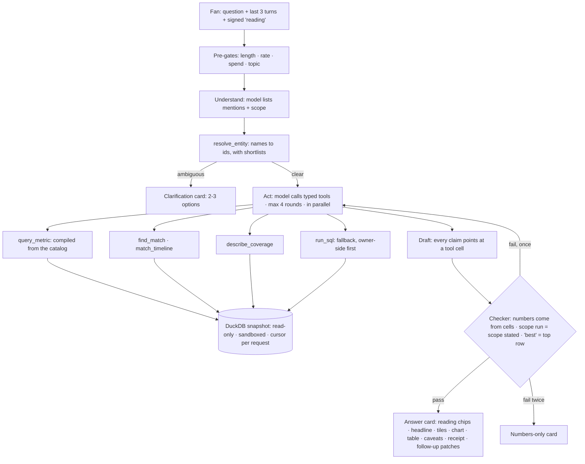
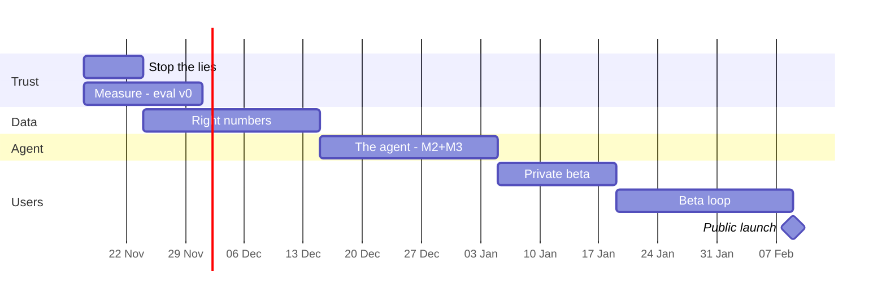

# CricPulse — End-to-End Review and the Road to a Live Agentic Product

**Date:** 16 Nov 2026 · **Branch:** `chore/M0b-seal` · **Status:** review, not yet approved
**Tested on:** snapshot `v20261112T1811Z`, with 23,239 matches and 11,739,043 balls, data to 3 Nov 2026. The model was `google/gemini-2.5-flash` via OpenRouter, live.
**How:** five reviewers ran in parallel: live test, agent architecture, data foundation, process and roadmap, and market. I then re-ran the headline findings myself; those are marked ✔.
**What was touched:** nothing in `src/`, `data/` or git changed. `data/` was opened read-only.

---

## 0. Verdict

1. **Today it is not useful.** It answered **5 of 26** real cricket questions correctly (19%), and one of those by luck. Every check is green: ruff is clean, 194 tests pass, and the UAT script passes 8/8. They pass because they test status codes, not answers.
2. **It is not agentic.** Three regexes send each message to one of three fixed scripts. The model writes one SQL string. Nobody checks its numbers, and nothing is remembered between messages.
3. **Seven root causes explain the failures (§3), and all are fixable.** None needs a new data source or a new framework.
4. **The idea is good and the lane is open.** AI cricket chat already exists: Google for the IPL, the ICC, Cricket Australia. None of them shows how its numbers are grounded. "Cricket answers you can quote, with receipts and honest coverage" is a real position. It only works if the numbers are right.
5. **The plan points the right way but moves too slowly.** One orchestrator, typed tools and a checker is the right design. At M0b's pace the first outside user arrives around March 2027. With eval-first weekly slices (§11), a private beta comes in about 8 weeks and public launch in about 12.

## 1. What is genuinely good — keep it

- **The data pipeline's safety design.** Versioned snapshots that never shrink, `LATEST.json` written last, quality gates and a run lock. A full rebuild takes 65 s.
- **The raw ball facts are sound.** Runs, balls and bowler wickets reconcile two ways: Kohli ODI 14,987 runs and 15,892 balls, Bumrah Tests 234 wickets.
- **The PRD's principle: "the AI only explains — it never invents".** Receipts, a checker, and "no data" as a valid answer. That principle is the product.
- **The HLD direction.** One orchestrator, typed tools, a checker, a stateless server and OpenRouter (ADR-5, 6, 7, 9).
- **Deterministic charts and stat tiles, the resolver's single-name ladder, and the catalog idea.** The concepts are right; the execution needs fixing.
- **The research.** 08 §3 and §13 and the agent-evals report are strong. The answers were mostly already written down; the code didn't follow them.

## 2. What happened when we used it

### 2.1 Scorecard

Live model, real snapshot, with ground truth computed by hand in read-only SQL. Appendix A has every question.

| Category | Asked | Right | What went wrong |
|---|---|---|---|
| Recall ("Kohli ODI runs", "most sixes IPL 2024") | 10 | 4 | names not matched; no IPL column; wrong T20I scope |
| Names (nickname, typo, ambiguous) | 4 | 1 | "MSD", "ABD" and "Sharma" all got "no data"; it never asks |
| Context and judgement | 4 | 0 | wrong phase; one invented matchup |
| Head-to-head | 2 | 0 | Kohli v Anderson (Tests) became a T20 report about Bumrah, all zeros |
| Match stories | 2 | 0 | both told the same Nepal league match from 3 Nov |
| Follow-up ("and in T20Is?") | 2 | 0 | no memory; the reply was an unrelated bowling table |
| Coverage (Tendulkar Tests) | 1 | 0 | said "no data", though the data has 6,416 runs for him |
| Hinglish ("Kohli ke T20 mein kitne run") | 1 | 0 | "no data" (13,315 in data) |
| **Cricket questions, total** | **26** | **5** | **19%** |
| Honesty / scope prompts | 4 | 3 OK | "yesterday's match" retold a game from 13 days earlier |
| Attacks through chat | 5 | 5 blocked | but the guard itself is open (§3, R5) |
| Odd inputs | 3 | 1 | empty message gave a random leaderboard; a 5,000-character message hung for more than 180 s |

- **Speed:** p50 4.8 s, p95 8.9 s, max 11.5 s, plus the hang.
- **Cost:** about $0.003–0.008 per answer. This is an estimate: 2–5 model calls and a prompt of about 2,600 tokens.

### 2.2 Five answers that tell the story

| You ask | It says | In the data | Why |
|---|---|---|---|
| How many ODI runs has Virat Kohli scored? | "It appears there's no data available…" | 14,987 | The SQL said `full_name = 'Virat Kohli'`; the data spells him `V Kohli` ✔ |
| Most sixes in IPL 2024 | "No data was returned…" | Abhishek Sharma, about 42 | The SQL said `match_type = 'IPL'`; there is no IPL column ✔ |
| Tell me the story of the 2023 ODI World Cup final | "Russell's All-Round Blitz Steals Thriller for Kings in Kirtipur!" | Australia won by 6 wickets | There is no match lookup; it takes the latest match ✔ |
| Kohli vs Anderson in Tests | A T20 report about Bumrah, with every number 0 | 305 runs, 710 balls, 7 dismissals | Matchups are hard-coded to T20; unresolved names default to Kohli and Bumrah |
| Most runs in men's T20 internationals | "RR Patel 524" (on 13 Nov: "Buttler 13,850") | Babar Azam, about 4,545 | Nothing marks international versus franchise matches |

The pattern: when it fails, it blames the data ("could be data limitations"). The data has the answer; the app cannot reach it.

## 3. The seven root causes, ranked by harm

### R1 — Names never reach the SQL as ids

- The resolver finds `V Kohli`, but the model still writes the literal "Virat Kohli". Most famous players come back empty.
- The same question returned 14,987 when phrased "V Kohli" and "no data" when phrased "Virat Kohli".
- Ordinary words get turned into teams on the real data ✔. "Who has the best strike rate in death overs?" injects *Belfast Wolves, Sylhet Strikers, MI Emirates, Delhi* into the prompt as "Pre-resolved Teams". "Is a spinner better at Chepauk?" adds *Cayman Islands, Kuwait, Spain*.
- `rapidfuzz` is not declared in `pyproject.toml` ✔, so the Docker image falls back to the slow pure-Python path.

### R2 — The data cannot tell an IPL match from a T20 international

- There is no `team_type`, competition or stage column. Gender is loaded but used nowhere.
- IPL 2008 is stored as season `2007/08` ✔.
- Renamed franchises are separate teams: Daredevils/Capitals, Kings XI/Punjab Kings, Bangalore/Bengaluru.
- All 10 catalog metrics, 5 golden queries, 3 marts, the matchup scout and the leaderboards are format-only. The Buttler-13,850 error is built into every one of them.

### R3 — Some of the cricket arithmetic is wrong

- **The wicket table has ids and names swapped in all 358,951 rows** ✔. `src/builder/loader.py:33` inserts by position, and the column orders differ. Any join on a dismissed player's id returns nothing.
- **Batting dismissals undercount.** They miss about 11,270 non-striker run-outs and count 360 retired-hurt or retired-not-out, so averages are inflated. Kohli's ODI average shows 59.47; the true figure is 58.54 (256 dismissals, not 252) ✔.
- **Super overs sit inside career totals, and ties have no winner.** The 2019 World Cup final reads `winner = None`.
- **The Hundred is filed as T20,** so its phases and overs are wrong.
- **Byes off a no-ball are charged to the bowler,** about 2,762 runs in total.
- **Identity splits and merges.** Sciver (4,248) and Sciver-Brunt (4,187) are two players. `GROUP BY full_name` merges five different Imran Khans.
- **Chase targets are not stored,** so required rate and win probability cannot be derived.
- **`matches_played` means "matches in which he faced a ball".**

The raw facts underneath are sound, so this is parser and model work, not new data. No quality gate caught any of it: the gates protect against losing data, not against wrong cricket.

### R4 — Silent fallbacks invent answers

- Unresolved names become Kohli and Bumrah (`src/ai/supervisor.py:77-80`). "How does Bumrah bowl against Kohli?" ran Bumrah against Bumrah.
- A story with no match id tells the latest match in the table.
- The matchup ignores the format and phase you asked for. No data shows as zeros.
- An empty message gets a random leaderboard.
- **The "Best Economy" tile names the *worst* bowler, and "Total Runs" adds different players' runs together** ✔. These tiles exist so the numbers "can't be hallucinated"; they aren't invented, but they're wrong.
- A missing API key makes every question return the canned line "Klaasen and Pooran dominate death overs" (`src/ai/gemini_client.py:22-24`).
- Keyword routing misfires. "Most runs against Pakistan" goes to the matchup scout. "Summary of Kohli's T20 career" becomes a recap of the latest match. "What is a no-ball?" goes to SQL.

### R5 — Serving is unsafe, and it returns wrong data under load

- **The SQL guard lets file reads through** ✔. `SELECT … FROM gold.dim_team t, LATERAL read_text('/etc/hosts') f` passes the guard and returns the file's contents.
  - The engine has no sandbox (M0a is not built), and `LIMIT 999999999` passes with no cap ✔.
  - On Cloud Run the API key would sit in an environment variable, which Linux exposes as `/proc/self/environ`. I did not test that path, but it is the obvious target.
  - Our five attack prompts were refused in chat, so the hole is one clever prompt away rather than open today.
  - 08 §2's note that "the guardrail is solid" is out of date.
- **`sort_by` in `/analytics` is SQL injection, no LLM needed** (`src/api/routes/analytics.py:35,77`). A subquery passed in `sort_by` ran.
- **One DuckDB connection is shared across threads.** 31 of 64 identical parallel requests came back **empty with HTTP 200**. A cursor per request fixes it.
- **No production controls.** There is no length cap, rate limit, spend cap or request timeout. Raw exceptions reach the user, and CORS is `*` with credentials.
- **Unescaped HTML.** The UI writes SQL result cells into the page as raw HTML (`index.html`, `innerHTML`).

### R6 — It never says what it doesn't know

- The data starts in December 2001 and has holes until about 2007: only 20 men's Tests in 2003 and 17 in 2004.
- In the data, Tendulkar has 6,416 Test runs (his record is 15,921) and Anderson 682 Test wickets (record 704). Bradman is in the player list with no balls.
- The app never says so. It also answers "yesterday's match" with a game from 13 days earlier.

### R7 — The tests can't see any of this

- Unit tests mock the model, and the UAT script checks status codes and "non-empty".
- The one time you asked a real question (13 Nov), the answer was wrong. That single hands-on question found more than both review rounds.

## 4. Is it agentic? What "agentic" should mean here

**Today: no.** Nothing the model does changes what happens next. It chooses no tools, never reads a result and re-plans, never asks, and remembers nothing. `session_id` is accepted and read nowhere.

**For CricPulse, "agentic" means five behaviours, each testable in evals:**
1. **Reads the question into a frame:** who, which metric, and what scope (format, gender, international or franchise, competition, period, phase).
2. **Resolves names before it queries.** Names become ids. If two readings differ, it asks with 2–3 tappable options, or goes ahead and says "I read this as …".
3. **Chooses tools and re-plans on what comes back.** An empty result means checking coverage and explaining. A small sample means fetching a baseline. A judgement question means several queries in parallel.
4. **Checks its own draft.** Every number points at a cell in a tool's output, and the scope it states matches the scope it ran.
5. **Carries the reading across turns.** "And in Tests?" changes one filter and nothing else.

**One orchestrator is enough.** Sub-agents add cost and delay without a use case yet; parallel tool calls cover "compare four players across three formats". Only two extra model calls are worth having: an isolated SQL writer inside the fallback tool, and offline triage of eval failures.

### What each part really is

| Part | Sold as | Really | Decision |
|---|---|---|---|
| `supervisor.py` | multi-agent supervisor | three regexes and an if/else; the model is used only when no keyword matches | delete |
| `text_to_sql.py` | text-to-SQL with three-turn self-correction | one prompt, SQL pulled out by regex, run, then a prose prompt; it only "corrects" DuckDB errors | rewrite as the guarded fallback tool |
| `tactical_scout.py` | tactical scout agent | fixed T20 SQL and one prose prompt | keep the SQL as a preset |
| `narrative_storyteller.py` | storyteller agent | three fixed queries and a prose prompt; no match lookup | keep the queries as `match_timeline` |
| `guardrails.py` | AST guardrail | a denylist that file reads get through | rewrite as an allowlist, plus an engine sandbox |
| `gemini_client.py` | Gemini client | a vendor-named POST to OpenRouter, with canned text when the key is missing | rewrite as a domain-named model gateway |
| `resolver.py` | 3-tier entity resolution | a good single-name ladder plus a harmful sentence scanner | keep the ladder; return shortlists |
| `semantic_catalog.yaml` | semantic layer | formula strings pasted into the prompt; not executable | extend into a compiler |
| `golden_queries.py` | golden SQL store | five keyword-ranked examples and three parametric functions | keep the functions |
| `chart_spec.py`, stat tiles | charts and key numbers | deterministic (good), but the tiles rank wrong | keep; fix |
| Chat UI `/ui` | answer card | clean, but sends no history and shows SQL and agent names to the public | keep; redesign the card |

## 5. The data foundation

### Coverage today

| Format | Gender | Matches | From | Note |
|---|---|---|---|---|
| Test | men | 899 | Dec 2001 | thin in 2003–04 |
| Test | women | 24 | 2003 | |
| ODI | men | 2,617 | Jun 2002 | |
| ODI | women | 620 | 2007 | |
| T20: internationals, franchise leagues and The Hundred mixed | men | 10,790 | Feb 2005 | cannot be split today |
| T20 | women | 3,633 | 2009 | |
| IT20: minor associate games | both | 320 | 2010 | **not** "T20 internationals" |
| ODM / MDM: domestic one-day and multi-day | both | 4,336 | 2006 | |

### The five abilities: what exists and what's missing

| Ability | Have | Missing | Where from |
|---|---|---|---|
| Recall | exact ball facts from 2002 | team type, event and stage, tie winner, target, balls per over, extras breakdown, super-over flag | already in the Cricsheet JSON; a parser change |
| Recall before 2002 | nothing | scorecard-era careers | no open ball-by-ball source; label the limit. Scraping ESPNcricinfo breaks its terms |
| Context | phase (wrong for The Hundred), venue name, date | canonical venues and teams, par scores, phase and era baselines | derived from our data plus alias sheets |
| Judgement | sample sizes | batting hand, bowling style, role, opposition strength | Wikidata (CC0) via the 18,653 Cricinfo ids is sparse, so hand-curate the top players; Elo ratings from our own results |
| Imagination | ball order, overs limit | per-ball innings state: score, wickets, balls left, target | derived, once targets and super overs are parsed |
| Honesty | data cutoff | a coverage table and a "complete through" date | derived |

### Proportion

**Keep:**
- the versioned snapshot and `LATEST.json`;
- the full Gold rebuild (65 s);
- the gates and the run lock.

**Cut candidate: the incremental Silver merge and its manifest and staging states,** in favour of a stateless nightly re-parse of `all_json` (about 39 s). It produced most of M0b's review findings, and a full re-parse removes that class of bug.

**Add cricket gates:**
- about 20 pinned figures that must match two ways;
- id columns that must look like ids;
- innings totals that reconcile with results.

**Gold shape.** Replace the three marts, each wrong in at least one way above, with about six wide, documented views the tools sit on: `balls`, `batting_innings`, `bowling_innings`, `matches`, `players` and `coverage`. Cricket formulas now live in three places (catalog, `schema.py`, `golden_queries.py`). Compile them from the catalog only, as invariant 4 already demands.

## 6. How it's being built

### Velocity

**Timeline:**
- **v1, with no process (31 Aug – 5 Sep):** it shipped the three blocking bugs.
- **Idle:** 50 days.
- **26 Oct:** the doc ladder and the M0b dossier.
- **Idle:** 7 days.
- **3–13 Nov:** M0b built and merged.

**M0b:**
- 11 cards were planned and 19 delivered.
- There were 6 blocked notes, and the decisions grew from 8 to 18.
- It took 2 review rounds and 3 UAT runs.
- The module's paperwork is 2,651 lines against 1,415 lines of product code (1.9 : 1).

**Projection.** At 18 days per module, assuming no scope growth:
- the first outside user (M5) arrives around early March 2027;
- public launch (M7) arrives around April–May 2027.

### What the ceremony caught, and what it cost

**Worth keeping:**
- The spike found a match that was silently lost and cut the snapshot from 1.1 GB to 0.4 GB.
- Real-data builds caught duplicate player rows and stale Silver.
- The fresh review caught overlapping runs that lost matches, and a false "Up to date".

**Pure cost:**
- Owns-list conflicts caused 3 of the 6 blocked notes.
- 26 handoff notes ran to 1,217 lines.
- UAT re-runs and git policy were filed as task cards.
- A separate branch was opened to flip one table cell.
- A scripted UAT on a mock model passed a wrong answer.

### The lightest process that still protects the invariants

- The invariants become CI tests and hooks: the never-shrink gates, the guard probe set, the checker's test set and a secret scan.
- A one-page plan per slice.
- A fresh review only when a diff touches a red zone: `src/publisher/`, `src/snapshot.py`, `src/ai/guardrails.py` or `src/config.py`.
- A real-data run before merging any pipeline change.
- **An eval gate plus 20 minutes of your own use on the live model,** instead of a signed UAT per module.

### Doc drift

The docs no longer match the code:
- **README:** describes Gemini 2.0, LangGraph, a SQLite ledger and a sync webhook. All of them are gone.
- **Root docs 01–07:** describe 6 dims, 5 facts and 7 marts (the code has 4, 4 and 3) and a Next.js front end (the PRD says chat only).
- **HLD:** marks PydanticAI "Accepted", but it is not in `pyproject.toml`.
- **`docs/04` §2:** says M0b is in "Deep dive", though it is merged.
- **HLD versus 08 §13:** the HLD says "never a guess", while 08 §13 says "just go".

**Fix:**
- move root 01–07 to `docs/archive/`;
- rewrite the README from the code;
- commit 08 and the research report.

## 7. Market and positioning

### Who already does this

| Who | What | Shows how numbers are grounded? |
|---|---|---|
| Google AI Mode, the IPL 2026 partner (about ₹270 cr over 3 years, reported) | live, player and history Q&A inside Search | no |
| ICC chat agent | 100k+ chats in 5 days; claims "99% accuracy" | claimed; method unstated |
| Cricket Australia Live | GPT-5 insight feed with follow-ups | not described |
| AskCricinfo (2021) | natural-language search over Statsguru | structured, but one-shot, not a conversation |
| CricMind.ai | IPL-only predictions and analytics | self-reported |
| Cricket Lens | a public chat that "argues back" | not stated |
| General AI chatbots | one informal test on 100 Cricsheet questions: GPT-5 right on 27%; a search model on 88% | no |

### Reality check on approach

These figures are reported by the sources, and some came via search summaries.
- **Semantic layers beat raw text-to-SQL.** dbt's 2026 test went from 90% to 98% and from 84% to 100%, and its failures became "can't answer" instead of a wrong number.
- **A cricket text-to-SQL benchmark (CricBench)** has the best model matching about 43% of answers from the schema alone.
- **Open text-to-SQL on cricket is not production grade.** That matches our own 19%.

### Licence

| Source | Terms | Notes |
|---|---|---|
| Cricsheet | ODC-By | Attribution is required. Get a legal read on commercial use. 386 Afghanistan matches are withheld, and some domestic leagues are partial. |
| Wikidata | CC0 | Has playing hand; no bowling-style property. |
| ESPNcricinfo / Cricbuzz | no reuse | Do not scrape. |
| Live data | Sportmonks, €29/month and up | Only if ever needed. |

### Avoid

- **A WhatsApp-first launch.** Meta barred general-purpose AI bots in October 2025, at its own discretion.
- **Anything near real-money fantasy.** It was banned in India in 2025.

### The bet

**"Cricket answers you can quote."** Verified numbers, stated scope, honest coverage, and a card you can share.
- **First audience:** writers, creators and stat-nerd fans who settle arguments in public.
- **Later:** the same typed tools offered as an MCP server for other AI agents.

## 8. Devil's advocate: the hard questions

1. **"Why not just ask Google or ChatGPT?"** They are free, everywhere, and fine for "who has the most runs". We can only win where they are weakest: deep ball-by-ball splits (phase, venue, matchup, era) with proof. *Test:* publish a head-to-head on the same 100 questions before the public launch. If we don't win it, we don't have a product yet.
2. **"Is Cricsheet enough?"** For splits since about 2005, yes. For "all-time" records and legends, no. Tendulkar shows 40% of his Test runs. Every career answer must say "in ball-by-ball data since Dec 2001", or users will catch us out on day one.
3. **"Is chat even the right interface for stats?"** Often a table with filters beats a paragraph. A chat-only product risks losing the very power users it targets. Answer: chat to ask, but the answer is a small live table with editable scope chips. Chat-first, not chat-only, still within the PRD's "no dashboards" rule.
4. **"Do we even need an LLM?"** For most questions a good form would do. The model's job is to understand messy language, resolve names, choose tools and explain, never to do arithmetic. If the model disappears tomorrow, the tools must still answer a structured query.
5. **"Can a free public endpoint survive?"** Today there are 2–5 model calls per answer, no cache and no caps. One viral post could drain the monthly budget in an hour. A cache keyed on the normalised question plus the snapshot version, rate limits, a spend cap and a cheap model are launch requirements, not polish.
6. **"Is the process the product?"** There are now about two lines of process for every line of product code. The most valuable check so far was you asking one real question. The process must shrink to the parts that protect the invariants.
7. **"Who is it for?"** The PRD lists fans, writers and coaches. Pick one for the beta. Writers and creators have the sharpest need (quotable, sourced numbers) and the best reach (they post).

## 9. The designer's view: what would make people come back

1. **"I read this as" chips** above every answer, e.g. `Men · T20 internationals · 2005 – 3 Nov 2026 · min 500 balls`. Tap one to change it and the answer re-runs. Invisible scope errors like the Buttler bug become visible one-tap fixes, and the chips teach people what they can ask.
2. **The receipt in cricket words, not SQL.** For example: "Counted 4,212 balls faced in 128 men's T20Is, Feb 2005 – 3 Nov 2026. Source: Cricsheet." The SQL moves behind a "for the nerds" fold.
3. **A share card.** One tap makes an image and a link with the number, scope and receipt. Every share is an ad that proves the promise, and that is the growth loop.
4. **"Settle it" mode.** "Kohli or Smith in chases?" builds a fair case for each side with context-adjusted numbers, then gives a verdict and states how sure it is. This turns the judgement ability into a feature people want.
5. **Honest limits as a feature.** "I don't have Tests before Dec 2001, so this undercounts Tendulkar by about 9,500 runs." That builds more trust than any accuracy claim.
6. **Follow-up chips that are filter changes** ("same, in Tests"), so they always work. Today they are plain text sent to a chat with no memory, so they cannot work.
7. **A "Wrong?" button on every number,** feeding a review queue that becomes new eval items. Users become the test team.
8. **Fix now:**
   - hide agent names and "POST /api/v1/ai/chat" from the public;
   - escape table cells;
   - stream tool status ("finding Kohli… counting ODIs…") so 5 s feels fast;
   - "21,000+ matches" is stale (it's 23,239).

## 10. Target architecture

### Rules that make it trustworthy

- **The model never writes a digit.** It writes claims with cell references, e.g. "{a} off {b} balls" → (result, row, column), and the server prints the numbers. Unlike the LLD's "number appears anywhere in the rows" checker, this also catches Warner's total attributed to Kohli.
- **Every query must state format, gender and match class.** A default is allowed only if it is stated in the reading chips.
- **No data is never shown as zeros.** An empty result gets a coverage explanation, and a small sample gets a caveat written by the server.
- **No free-form SQL on the public path at launch.** When no tool fits, the answer is "I can't answer that yet" and the question is logged. That log is the backlog.
- **Stateless server.** The client sends the last 3 turns and the signed previous reading. Tool results are always re-run, never trusted from the client.

### Tools

There is one compiler, not eight bespoke stat tools.

| Tool | Job |
|---|---|
| `resolve_entity(mention, kind?, context)` | unique, ambiguous or none, with candidates (id, display name, disambiguator, score) |
| `describe_coverage(topic?)` | metrics, dimensions, date range, known gaps |
| `query_metric(metrics, role, filters, group_by, grain, rank?, qualifier?, threshold?)` | leaderboards, comparisons, splits and matchups. `format`, `match_class` and `gender` are required. `grain` + `threshold` covers "most fifties" |
| Presets over `query_metric` | leaderboard · compare (2–4 players) · matchup with both baselines · phase profile |
| `find_splits(entity, metric, filters, dims)` | the biggest deviations from baseline, with sample sizes; feeds context and judgement |
| `find_match(teams?, date?, event?)` · `match_timeline(match_id)` | stories and recaps |
| `run_sql(request, why_no_metric)` | guarded fallback, flagged "unverified" |
| Later: `rules_lookup`, `win_probability(state)`, `simulate(state)` | knowledge and imagination |

**Output** is one of three types: `Answer`, `Clarification{question, options[2..3]}` or `CannotAnswer{reason, nearest}`.

### Platform

These decisions mostly already exist in the HLD.
- **Orchestrator and models:** a PydanticAI orchestrator (ADR-6) behind a domain-named model gateway, using OpenRouter (ADR-7) with a fallback model.
- **Hosting:** a Cloud Run service plus a nightly Cloud Run Job (ADR-2), on immutable snapshots (ADR-3).
- **DuckDB hardening:**
  - external access off and configuration locked;
  - a memory limit;
  - a cursor per request;
  - an interrupt timeout;
  - a row cap via `fetchmany`.
- **Tracing:** one structured trace line per answer (tools, tokens, cost, latency, checker result) first; Langfuse later.

## 11. Roadmap: eval-first weekly slices

This assumes about three working evenings a week; the observed pace is closer to two. Every slice ends with the eval score up and 20 minutes of your own hands-on use. Dates assume a start on 17 Nov 2026.

| Weeks | Slice | Ships | Exit bar |
|---|---|---|---|
| 1 | **Stop the lies** | No more silent defaults (Kohli/Bumrah, latest match); empty and over-long input refused; timeouts; a cursor per request; DuckDB sandbox, allowlist guard and row cap; `/analytics` removed (or `sort_by` allowlisted); stat tiles fixed; UI cells escaped; honest errors. M0b closed with the Buttler bug logged as the first data item; root docs archived; README rewritten from code | 64/64 parallel requests right; all guard probes blocked; no answer built on a default |
| 1–2 | **Measure** (alongside) | Eval v0: 40 questions with ground truth (Appendix A gives the first 26). One command runs it against the live model and reports accuracy, ask rate, cost and latency | Baseline published (today about 19%) |
| 2–4 | **Right numbers** | Parser v2: team type, event and stage, tie winner, target, balls per over, extras breakdown, super-over flag. The wicket-table insert fixed; a dismissals table; canonical teams and venues; season mapped to year. A coverage view and `snapshot_info`. Six wide views; the marts retired. Cricket gates with about 20 pinned figures | The pinned figures match two ways |
| 5–7 | **The agent** (M2 + M3 merged) | Orchestrator; `resolve_entity`, `query_metric` with presets, `find_match`/`match_timeline` and `describe_coverage`; the claim-reference checker; reading chips; follow-ups as patches; receipts in cricket words | Eval ≥85% on ≥60 items; 0 untraceable numbers; asks on ambiguous names |
| 8–9 | **Private beta** | Cloud Run deploy (D-15 items); rate limit; daily spend cap; cache; one trace line per answer; "Wrong?" button; Cricsheet attribution; privacy note; 10–20 invited writers and fans | p95 ≤15 s; cost per answer measured |
| 10–12 | **Beta loop** | Every week: read 30–50 traces, turn failures into evals (towards 150), fix the top failure class. Add context: phase, venue and era baselines, and "true" strike rate and economy. Add share cards | Eval ≥90% on 150; 0 untraceable numbers; p95 ≤10 s; cost within budget |
| 13 (~9 Feb 2027) | **Public launch** | A published head-to-head against general assistants on the same questions; a coverage page; a red-team pass | The launch bar holds for 2 weeks |
| After | **Judgement and imagination** | "Settle it" mode; player and venue cards (Wikidata CC0); innings-state table, then win probability and what-if; rules explainers; Hindi; an MCP server | — |

### Launch bar

| Measure | Private beta | Public |
|---|---|---|
| Lookup accuracy | ≥85% on ≥40 | ≥90% on ≥150 |
| Numbers not traceable to a tool | 0 | 0 |
| Asks when it should (names, scope) | measured | ≥80%, over-asking ≤10% |
| p95 full answer | ≤15 s | ≤10 s |
| Cost per answer | measured | ≤$0.004 (₹1,000 ÷ about 3,000 answers a month) |

### Cut until after launch

- **The autonomy dial:** ship "ask when unsure, with a stated default" instead.
- **Playing styles.**
- **Langfuse.**
- **M8–M12.**
- **Token streaming:** stream tool status instead, and send the answer once it has passed the checker.

## 12. Your decisions

1. **Switch to eval-first weekly slices** instead of M0a→M12 one module at a time? *Recommended.* The order of trust is the same (safe, then correct, then agent, then users); the process around it gets lighter.
2. **No free-form SQL on the public path at launch:** typed tools only, with unanswerable questions logged as the backlog? *Recommended.* Text-to-SQL on cricket tops out around 43% in the published benchmark, and we measured 19%.
3. **Ambiguity rule: "ask when unsure, with a stated default"**, with the autonomy dial later? *Recommended.*
4. **First audience: writers, creators and stat-nerd fans**, growing through share cards? *Recommended.*
5. **Budget: is ₹1,000 a month still the cap?** It sets cost per answer at ≤$0.004 and decides the model.

**Owner's answers, 17 Nov 2026:**
1. Keep one module at a time.
2. Building for me, so there is no public path.
3. Ask.
4. I am the user.
5. Personal use, local LLMs, a fully open-source local stack.

The follow-up plan is `PLAN-LOCAL-OSS-REVAMP-2026-11-17.md`.

---

## Appendix A — the question battery (the seed for eval v0)

Ground truth comes from read-only SQL on `v20261112T1811Z`. Values marked ≈ use a team-name proxy for IPL or international matches, because the data lacks `team_type` and competition. They become exact after parser v2.

| # | Question | In the data | Today |
|---|---|---|---|
| 1 | Who has the most runs in men's T20 internationals? | Babar Azam ≈4,545 | RR Patel 524 ✗ |
| 2 | How many ODI runs has Virat Kohli scored? | 14,987 | "no data" ✗ |
| 3 | Top 5 wicket-takers in Test cricket | Anderson 682, Broad 604, Lyon 577, Ashwin 532, Starc 460 (since 2001) | ✓ |
| 4 | Most sixes in IPL 2024 | Abhishek Sharma ≈42 | "no data" ✗ |
| 5 | Best bowling figures in an ODI innings | Afridi 7/12, McGrath 7/15, King 7/18 | ✓ |
| 6 | Jasprit Bumrah's economy rate in T20Is | 7.06, over all T20 (needs team type) | 7.06 ✓ by luck |
| 7 | Highest team total in men's ODIs | England 498 | ✓ |
| 8 | How many Test centuries has Joe Root scored? | 41 | "none" ✗ |
| 9 | Most runs at the Wankhede in the IPL | Rohit Sharma ≈2,625 | "none" ✗ |
| 10 | Smriti Mandhana's runs in women's ODIs | 4,760 | "no data" ✗ |
| 11 | How many runs has MSD scored in the IPL? | ≈5,155 | "no data" ✗ |
| 12 | Jaspreet Bumra wickets in tests (typo) | 234 | ✓ |
| 13 | Sharma's batting average in ODIs (ambiguous) | should ask; Rohit Sharma 50.7 | "no data" ✗ |
| 14 | ABD strike rate in the IPL | ≈151.6 | "no data" ✗ |
| 15 | Is Bumrah better than Starc at the death in T20s? | economy 7.83 vs 9.18 (plus context) | "no data" ✗ |
| 16 | Who should bowl the 19th over against Jos Buttler? | over-19 samples are tiny (3 balls); it should say so | all-phase numbers ✗ |
| 17 | Best batters against left-arm spin, IPL middle overs | no bowling-style data; it should say so | invented matchup ✗ |
| 18 | Was Kohli's 2016 IPL season the best ever? | Kohli 973 in 2016 | wrong scope ✗ |
| 19 | Kohli vs Anderson in Tests | 305 runs, 710 balls, 7 dismissals | zeros, Bumrah text ✗ |
| 20 | Rohit Sharma against Trent Boult | ODI 132/177/4 · T20 75/57/6 · Test 70/157/1 | zeros ✗ |
| 21 | Story of the 2023 ODI World Cup final | match 1384439, Australia won by 6 wickets, Head player of the match | Nepal league match ✗ |
| 22 | Recap the last IPL final | match 1535465, RCB beat GT by 5 wickets, 31 May 2026 | Nepal league match ✗ |
| 23 | Most runs in IPL history? | Kohli ≈9,200 | "no data" ✗ |
| 24 | …and in T20Is? (follow-up) | needs memory | unrelated table ✗ |
| 25 | How many Test runs did Sachin Tendulkar score? | 6,416 in data since 2001 (record 15,921), with a coverage note | "no data" ✗ |
| 26 | Kohli ke T20 mein kitne run hai? | 13,315 (all T20) | "no data" ✗ |

Add before eval v0 runs: the Buttler/Babar pair, ten ambiguity items (answer is *ask*), five refusals (future, betting, non-cricket), five coverage items (pre-2001), and the guard probe set as a separate security suite.
